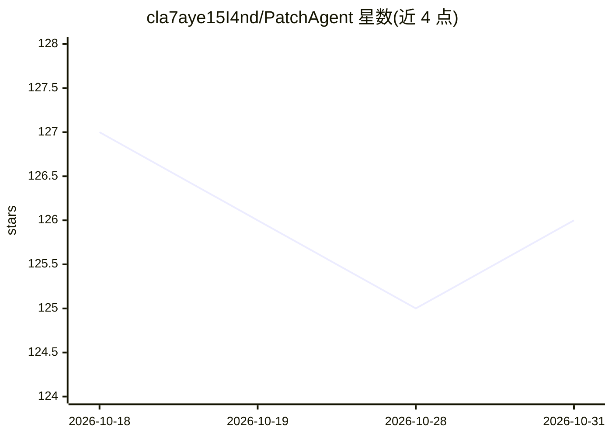

# cla7aye15I4nd/PatchAgent

⭐ 126 · Python · Apache-2.0 · 推送 2026-02-25 · [GitHub](https://github.com/cla7aye15I4nd/PatchAgent) · [官网](https://www.dataisland.org/patchagent) · 组织维护

**面向真实漏洞的 LLM 自动程序修复 agent（USENIX Sec 25）**

基于 LLM 的程序修复 agent，模仿人类专家流程为真实世界的漏洞自动生成补丁。集成语言服务器协议（LSP）做代码导航分析、补丁验证机制确保修复正确安全、交互优化实现类人推理。支持 C/C++ 与 Java，覆盖 ASan/MSan/UBSan/TSan/Jazzer 等消毒器，可对接 OSS-Fuzz。已修复 assimp、libssh2、hdf5、Linux 内核等多个项目的漏洞，论文发表于 USENIX Security 2025。以 Docker 镜像分发，需 Python 3.12+ 与配置 LLM API key。

## 筛选速览

| 维度 | 判定 | 备注 |
|---|---|---|
| AI 角色 | `ai-native` | 本体是模型或模型工具 |
| 许可风险 | `permissive` | Apache-2.0 |
| 部署形态 | `self-host` | docker 或自建部署 |
| 模型依赖 | — | README 未给出锁定关系 |
| 硬件要求 | — | 无带数字的原话,不猜 |
| 安装摩擦 | `low` | 无编译、无系统依赖或容器化 |
| 成熟度 | — | 结构信号不足 |

## 能力要点

- 集成语言服务器协议（LSP）做代码导航与分析
- 补丁验证机制确保修复正确安全
- 支持 C/C++ 与 Java，覆盖 ASan/MSan/UBSan/TSan/Jazzer
- 已在 Linux 内核、libssh2 等真实项目修复漏洞并获 CSAW ARC 2025 二等奖

## 适用场景

- 自动为 C/C++ 与 Java 项目的真实漏洞生成补丁
- 配合 OSS-Fuzz 修复消毒器报告的内存/线程安全问题
- 安全研究中辅助漏洞修复流程

## 场景标签

`网络安全` `编码 Agent` · 领域:编码与开发

## 证据(README 行号)

> L20: PatchAgent is an LLM-based program repair agent that mimics human expertise to automatically generate patches for r
> L31: - Docker (for OSS-Fuzz integration)

## 星数曲线

2026-10-18 127 → 2026-10-31 126（-1）

---
*卡片 v1 · prompt 1.4 · 生成 2026-10-23 · 置信度 high · 依据 README sha `a3f4b03b41b2` · [字段定义](../../DATASET.md)*
