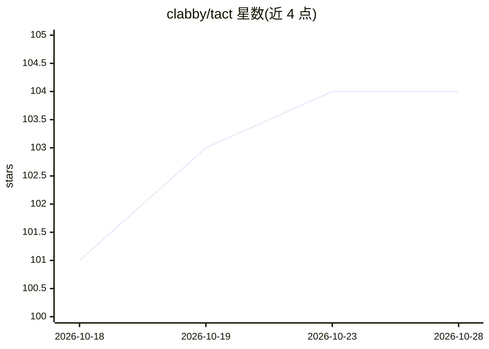

# clabby/tact

⭐ 104 · Rust · Apache-2.0 · 推送 2026-10-28 · [GitHub](https://github.com/clabby/tact) · 个人维护

**终端编码 Agent：驱动 GPT-6 与 Claude 模型改代码、审代码**

基于 Nanocodex 的终端编码代理，开箱运行 OpenAI GPT-6 模型，也可驱动 Anthropic Claude 模型（默认关闭）。每个进程附带 Web 界面，可从浏览器或手机访问，含代码审查面板、实时 diff 与行内评论。支持子代理委派、跨会话长期记忆（本地 SQLite 或远端团队后端）、技能加载与 MCP 服务器调用。提供安装脚本、crates.io 与容器镜像分发。注意：不沙箱化代理命令，代理以用户权限读写文件并运行进程。

## 筛选速览

| 维度 | 判定 | 备注 |
|---|---|---|
| AI 角色 | `ai-native` | 本体是模型或模型工具 |
| 许可风险 | `permissive` | Apache-2.0 |
| 部署形态 | `library` | 以包/库形式分发 |
| 模型依赖 | locked-api |  |
| 硬件要求 | — | 无带数字的原话,不猜 |
| 安装摩擦 | `medium` | 含编译或系统依赖之一 |
| 成熟度 | — | 结构信号不足 |

## 能力要点

- 终端 UI 与同进程 Web 界面双前端，共享会话、草稿与记录
- 子代理委派（默认开启，并发上限默认 32）
- 跨会话记忆：本地 SQLite 或远端团队命名空间后端
- 支持 MCP 服务器、技能加载与 Tailscale 远程访问

## 适用场景

- 在终端里让 AI 代理读写代码并执行任务
- 在浏览器或手机上继续查看和操控终端中的代理会话
- 通过分支审查面板做 AI 代码评审并回发给代理

## 场景标签

`编码 Agent` `代码审查` `Agent 记忆` · 领域:Agent 开发

## 证据(README 行号)

> L8: Tact is a coding agent for your terminal, built on Nanocodex.
> L9: It runs OpenAI's GPT-6 models out of the box and can also drive Anthropic's Claude models. Alongside

## 星数曲线

2026-10-18 101 → 2026-10-28 104（+3）

---
*卡片 v1 · prompt 1.4 · 生成 2026-10-23 · 置信度 mid · 依据 README sha `09b2f79be719` · [字段定义](../../DATASET.md)*
