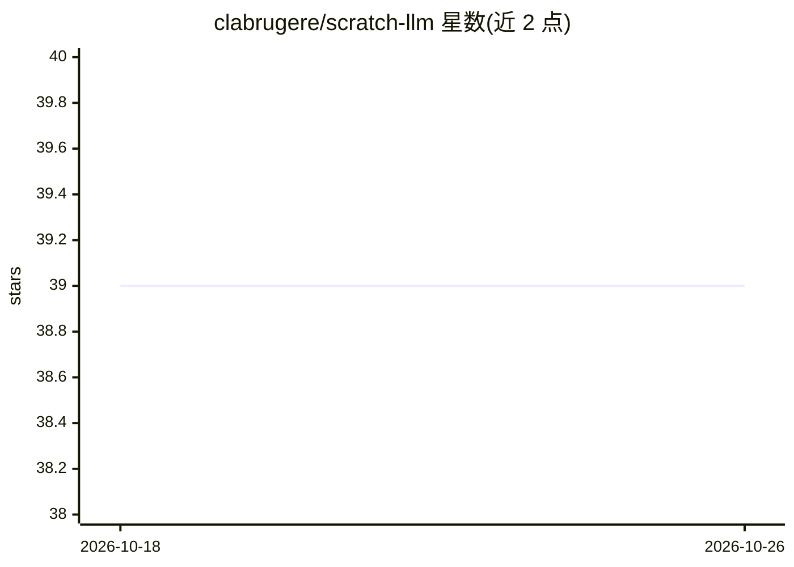

# clabrugere/scratch-llm

⭐ 39 · Python · MIT · 推送 2026-06-12 · [GitHub](https://github.com/clabrugere/scratch-llm) · 个人维护

**PyTorch 从零实现 Llama 2 风格 Transformer，用于学习 LLM 原理**

教学用途的 Llama 2 启发式 Transformer 从零实现，仅依赖 Python 3.11 与 PyTorch 2.6+。涵盖 Llama 2 的三项改进：RoPE 旋转位置编码、RMS 预归一化、SwiGLU 激活；并实现自研 BPE 分词器（双向链表 + 惰性堆加速的 O(1)/O(log n) 实现）。端到端流程：在小语料上训练分词器与模型并保存 checkpoint，随后可加载生成文本。明确不做训练/推理优化（不用 flash-attention CUDA 内核、无分布式并行），提供 CLI 与 notebook 示例，示例模型约 3M 参数。

## 筛选速览

| 维度 | 判定 | 备注 |
|---|---|---|
| AI 角色 | `ai-native` | 本体是模型或模型工具 |
| 许可风险 | `permissive` | MIT |
| 部署形态 | `None` |  |
| 模型依赖 | — | README 未给出锁定关系 |
| 硬件要求 | — | 无带数字的原话,不猜 |
| 安装摩擦 | `medium` | 含编译或系统依赖之一 |
| 成熟度 | — | 结构信号不足 |

## 能力要点

- 实现 RoPE、RMSNorm、SwiGLU 等 Llama 2 关键组件
- 自研 BPE 分词器，基于双向链表与惰性堆优化复杂度
- CLI 一键完成训练分词器、预训练模型并保存 checkpoint
- 提供 tinyshakespeare 端到端 notebook 示例（约 3M 参数模型）

## 适用场景

- 逐行阅读代码理解 LLM 内部机制（注意力、位置编码、归一化）
- 在小语料上亲手完成 BPE 训练与模型预训练全流程
- 理解 BPE 分词器的高效实现与原理

## 场景标签

`教程课程` · 领域:学习与行业

## 证据(README 行号)

> L3: This repository contains a rather simple implementation of Meta's famous Llama large language model using Pytorch. T
> L11: To make the implementation end-to-end, we train the model on a small dataset using a custom BPE tokenizer.

## 星数曲线

2026-10-18 39 → 2026-10-26 39（+0）

---
*卡片 v1 · prompt 1.4 · 生成 2026-10-25 · 置信度 high · 依据 README sha `56c5cbc5775b` · [字段定义](../../DATASET.md)*
