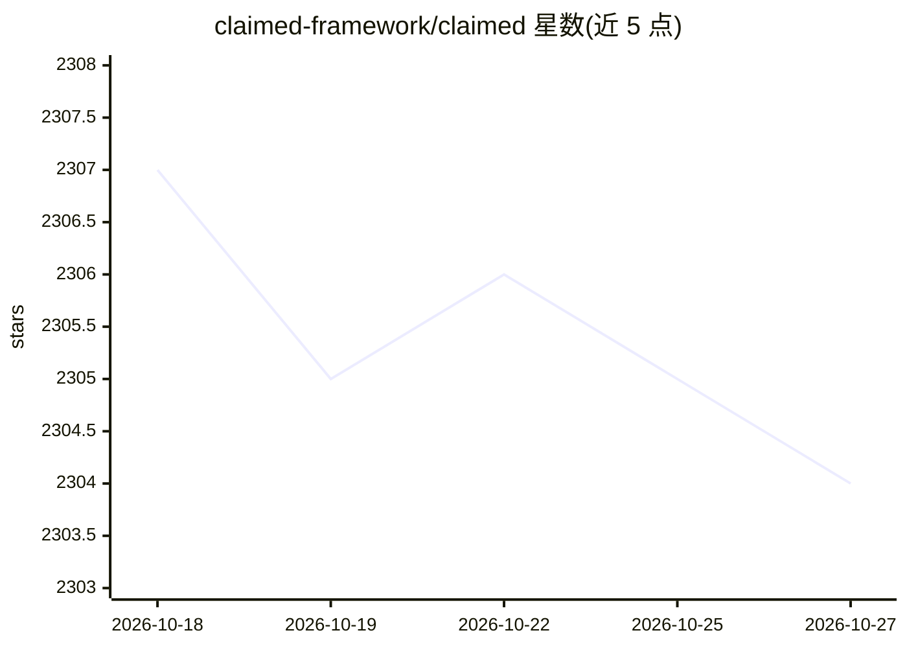

# claimed-framework/claimed

⭐ 2,304 · Jupyter Notebook · Apache-2.0 · 推送 2026-10-25 · [GitHub](https://github.com/claimed-framework/claimed) · 组织维护

**把脚本/笔记本编译为容器化 AI 组件与 Kubeflow 流水线的工具**

CLAIMED Component Compiler（C3）是 CLAIMED 低代码框架的核心项目：读取 Jupyter notebook、Python 或 R 脚本，自动安装依赖、构建容器镜像并推送镜像仓库，生成 Kubeflow Pipeline 组件（执行引擎可插拔）与 Kubernetes/Openshift 作业配置，可由 CI/CD 流水线触发。网格并行化支持 AI 负载分布式执行，MLX 作为后端负责资产追踪（数据/模型/作业）与生命周期管理。README 后半部分捆绑了 terratorch-iterate 文档：基于 MLFlow、Optuna、Ray 的基准测试与超参优化工具，支持 Slurm/LSF 工作负载管理器。由 EU Horizon Europe 等资助，Apache 2.0 许可。

## 筛选速览

| 维度 | 判定 | 备注 |
|---|---|---|
| AI 角色 | `ai-ecosystem` | LLM/agent 周边工具 |
| 许可风险 | `permissive` | Apache-2.0 |
| 部署形态 | `library` | 以包/库形式分发 |
| 模型依赖 | — | README 未给出锁定关系 |
| 硬件要求 | — | 无带数字的原话,不猜 |
| 安装摩擦 | `low` | 无编译、无系统依赖或容器化 |
| 成熟度 | — | 结构信号不足 |

## 能力要点

- 脚本/笔记本自动构建容器镜像并推送仓库
- 生成 Kubeflow Pipeline 组件与 Kubernetes 作业配置（引擎可插拔）
- MLX 作为网格计算后端追踪数据/模型/作业等资产
- 捆绑 terratorch-iterate：基于 MLFlow/Optuna/Ray 的基准测试与超参优化

## 适用场景

- 把现有 Python/R 脚本快速容器化为可复用的流水线组件
- 在 Kubernetes/OpenShift 集群上分布式运行 AI 工作负载
- 对 TerraTorch 模型做多任务基准测试与超参调优

## 场景标签

`工作流自动化` `MLOps` · 领域:效率与自动化

## 证据(README 行号)

> L10: - creates KubeFlow Pipeline components (target workflow execution engines are pluggable)
> L15: It automates the transformation of arbitrary code assets — such as Jupyter notebooks, Python scripts, or R scripts 

## 星数曲线

2026-10-18 2,307 → 2026-10-27 2,304（-3）

---
*卡片 v1 · prompt 1.4 · 生成 2026-10-21 · 置信度 high · 依据 README sha `efe4f2d76c83` · [字段定义](../../DATASET.md)*
