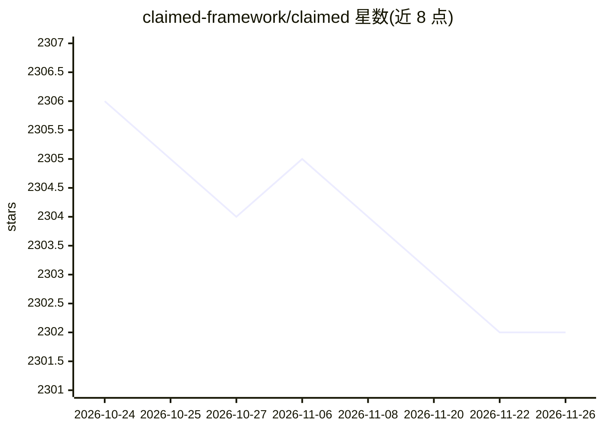

# claimed-framework/claimed

⭐ 2,302 · Jupyter Notebook · Apache-2.0 · 推送 2026-11-20 · [GitHub](https://github.com/claimed-framework/claimed) · 组织维护

**将脚本/笔记本编译为可部署 AI 组件的低代码工具链**

CLAIMED 框架的核心项目 C3：以 Jupyter notebook、Python 或 R 脚本为输入，自动构建容器镜像并推送到镜像仓库，自动安装依赖，生成 KubeFlow Pipeline 组件与 Kubernetes/OpenShift 作业配置，可由 CI/CD 管道触发。内置网格计算并行化以在异构计算环境分布式执行 AI 工作负载，并以机器学习交换（MLX）作为后端跟踪数据、模型与作业等资产。仓库还捆绑 terratorch-iterate，一个基于 MLFlow、Optuna 与 Ray 的基准测试与超参数优化工具。pip 安装，Apache-2.0 许可，由欧盟 Horizon Europe 等项目资助。

## 筛选速览

| 维度 | 判定 | 备注 |
|---|---|---|
| AI 角色 | `ai-ecosystem` | LLM/agent 周边工具 |
| 许可风险 | `permissive` | Apache-2.0 |
| 部署形态 | `library` | 以包/库形式分发 |
| 模型依赖 | — | README 未给出锁定关系 |
| 硬件要求 | — | 无带数字的原话,不猜 |
| 安装摩擦 | `low` | 无编译、无系统依赖或容器化 |
| 成熟度 | — | 结构信号不足 |

## 能力要点

- 自动将脚本/笔记本转为容器镜像与 KubeFlow Pipeline 组件
- 网格计算并行化支持异构环境的分布式执行
- MLX 后端统一跟踪数据、模型、作业等资产
- 捆绑 terratorch-iterate 提供 HPO 与基准测试

## 适用场景

- 把现有 notebook/脚本快速容器化并部署到 Kubernetes 集群
- 在 CI/CD 流水线中触发组件构建与部署
- 对 TerraTorch 骨干模型做基准测试与超参数调优

## 场景标签

`MLOps` · 领域:训练与推理

## 证据(README 行号)

> L10: - creates KubeFlow Pipeline components (target workflow execution engines are pluggable)
> L14: C3 (CLAIMED Component Compiler) is the central project of the CLAIMED framework.
> L15: It automates the transformation of arbitrary code assets — such as Jupyter notebooks, Python scripts, or R scripts 

## 星数曲线

2026-10-24 2,306 → 2026-11-26 2,302（-4）

---
*卡片 v1 · prompt 1.4 · 生成 2026-11-23 · 置信度 high · 依据 README sha `3aab86dc255b` · [字段定义](../../DATASET.md)*
