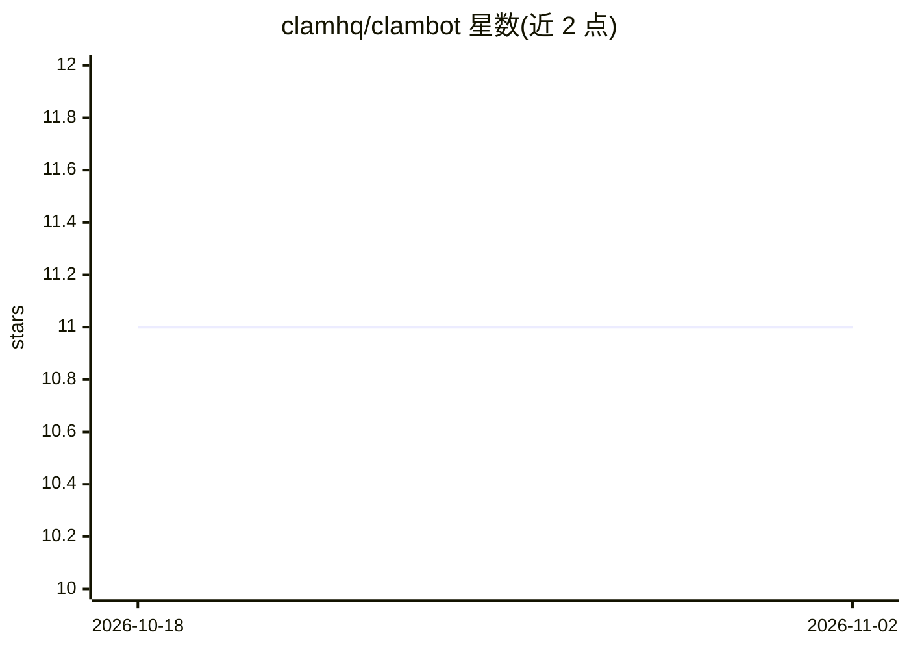

# clamhq/clambot

⭐ 11 · Python · MIT · 推送 2026-05-14 · [GitHub](https://github.com/clamhq/clambot) · [官网](https://clambot.ai) · 个人维护

**个人 AI 助手：LLM 生成代码在 WASM 沙箱内执行**

面向个人用户的安全导向 AI 助手：LLM 将请求生成名为 clam 的 JavaScript 脚本，全部在 QuickJS/Wasmtime WASM 沙箱中运行，内存隔离且无环境网络访问；工具调用回传 Python 经能力检查与交互审批后分发，成功脚本可持久化复用。支持 OpenAI Codex（推荐测试路径）、OpenRouter、Anthropic、Ollama 等多提供商，内置文件、HTTP、网页搜索、转录、PDF、cron 等工具，提供 CLI 与 Telegram 渠道。通过 git clone 加 uv 运行，主要在 Linux 上测试。

## 筛选速览

| 维度 | 判定 | 备注 |
|---|---|---|
| AI 角色 | `ai-native` | 本体是模型或模型工具 |
| 许可风险 | `permissive` | MIT |
| 部署形态 | `library` | 以包/库形式分发 |
| 模型依赖 | local-ok | 支持本地模型 |
| 硬件要求 | — | 无带数字的原话,不猜 |
| 安装摩擦 | `low` | 无编译、无系统依赖或容器化 |
| 成熟度 | — | 结构信号不足 |

## 能力要点

- LLM 生成代码全部在 WASM 沙箱（QuickJS/Wasmtime）内运行，无环境网络访问
- SHA-256 指纹化的工具审批门（always-grants / 回合级授权）
- 成功脚本持久化复用，相同请求零 LLM 调用
- 多提供商支持：OpenAI Codex、OpenRouter、Anthropic、Ollama、Gemini、DeepSeek 等

## 适用场景

- 通过 CLI 或 Telegram 与个人 AI 助手对话完成网页抓取、转录、PDF 提取等任务
- 在不直接执行任意代码的前提下运行 LLM 生成的脚本
- 用 cron 和心跳服务让 agent 定时主动执行任务

## 场景标签

`AI 助手` `网页抓取` `工作流自动化` · 领域:效率与自动化

## 证据(README 行号)

> L7: 🐚 **ClamBot** is a security-focused personal AI assistant that runs all LLM-generated code inside a **WASM sandbox**
> L16: 1. 🤖 LLM generates a JavaScript **"clam"** (named, versioned, reusable script)
> L49: After onboarding, users can immediately:

## 星数曲线

2026-10-18 11 → 2026-11-02 11（+0）

---
*卡片 v1 · prompt 1.4 · 生成 2026-11-02 · 置信度 mid · 依据 README sha `98fa936b900c` · [字段定义](../../DATASET.md)*
