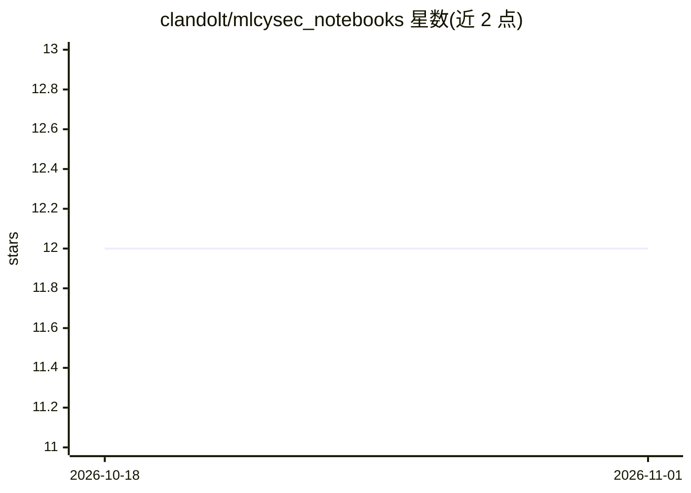

# clandolt/mlcysec_notebooks

⭐ 12 · Jupyter Notebook · MIT · 推送 2026-01-16 · [GitHub](https://github.com/clandolt/mlcysec_notebooks) · [官网](https://christophlandolt.com/mlcysec_notebooks/) · 组织维护

**萨尔大学机器学习与网络安全课程的 Jupyter 教程仓库**

CISPA/萨尔兰大学 2025/26 冬季学期《Machine Learning in Cybersecurity》课程的 Jupyter notebook 教程集合，主题涵盖 ML 基础、训练机器学习入侵检测系统（IDS）、对抗样本规避 ML IDS、AI 用于 CTF 等练习。教程可在浏览器在线阅读，也可本地运行（CPU 即可、无需 GPU）或通过 Google Colab 运行（可开 GPU）。首个版本，欢迎通过 issue 反馈。

## 筛选速览

| 维度 | 判定 | 备注 |
|---|---|---|
| AI 角色 | `ai-knowledge` | 知识聚合/清单类 |
| 许可风险 | `permissive` | MIT |
| 部署形态 | `None` |  |
| 模型依赖 | — | README 未给出锁定关系 |
| 硬件要求 | `cpu-ok` | |
| 安装摩擦 | `low` | 无编译、无系统依赖或容器化 |
| 成熟度 | — | 结构信号不足 |

## 能力要点

- 覆盖训练 ML IDS、规避 ML IDS、AI for CTF 的课程练习教程
- 支持浏览器在线阅读、本地 CPU 运行、Google Colab 三种方式
- notebook 设计为在普通笔记本上运行，无需 GPU

## 适用场景

- 跟着课程动手学习机器学习在网络安全中的应用
- 学习训练与攻击机器学习入侵检测系统
- 在 Colab 上用 GPU 跑教程 notebook

## 场景标签

`网络安全` `教程课程` · 领域:学习与行业

## 证据(README 行号)

> L3: Repository of Jupyter notebook tutorials for teaching the Machine Learning in Cybersecurity Course at the Saarland U
> L41: |**12.11.2025**|16:15–17:45|Introduction Ex1: Train ML IDS|

## 星数曲线

2026-10-18 12 → 2026-11-01 12（+0）

---
*卡片 v1 · prompt 1.4 · 生成 2026-11-01 · 置信度 high · 依据 README sha `467fc909c01e` · [字段定义](../../DATASET.md)*
