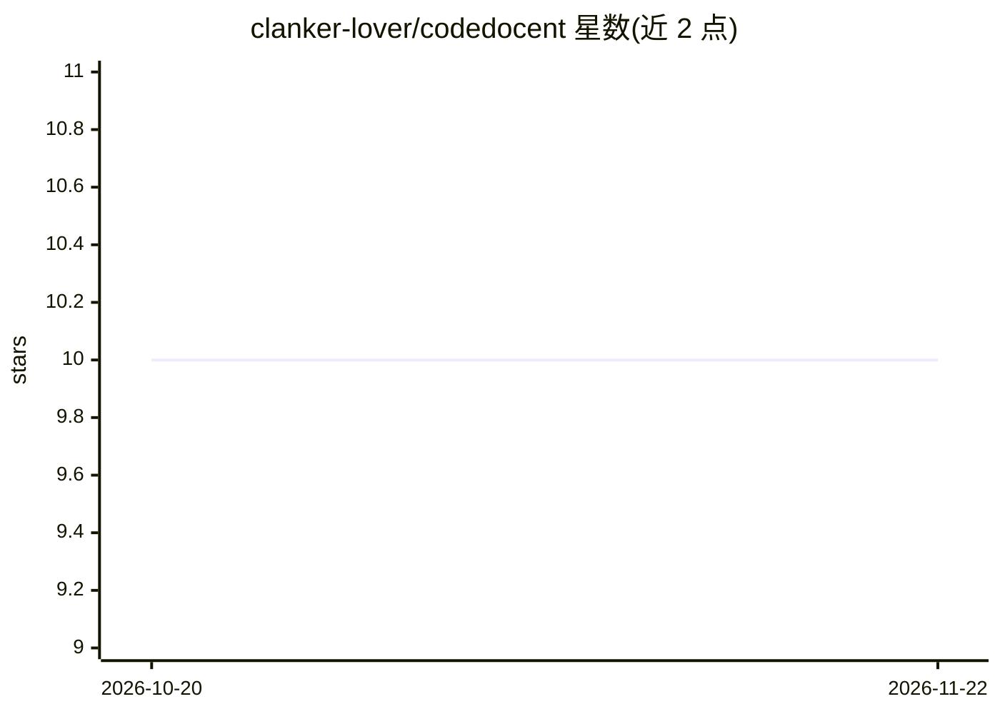

# clanker-lover/codedocent

⭐ 10 · Python · MIT · 推送 2026-04-06 · [GitHub](https://github.com/clanker-lover/codedocent) · 个人维护

**面向非程序员的代码库可视化与解读工具**

把代码库解析为可导航的可视化块结构，并用 AI 为每个块生成通俗说明：目录/文件/类/函数的嵌套彩色块、文件角色与关键概念摘要、质量警告、可下钻交互浏览，也可导出为自包含静态 HTML 分享。v1.0 新增依赖图架构模式（4 级下钻、D3 力导向图、可导出 MD 喂给 AI 工具）。支持云 AI（OpenAI/OpenRouter/Groq/兼容端点）、本地 Ollama 或 --no-ai 纯静态模式。面向不熟悉代码库的开发者、经理/设计师/PM、接手遗留代码者、审查者与学生。

## 筛选速览

| 维度 | 判定 | 备注 |
|---|---|---|
| AI 角色 | `ai-native` | 本体是模型或模型工具 |
| 许可风险 | `permissive` | MIT |
| 部署形态 | `library` | 以包/库形式分发 |
| 模型依赖 | local-ok | 支持本地模型 |
| 硬件要求 | — | 无带数字的原话,不猜 |
| 安装摩擦 | `low` | 无编译、无系统依赖或容器化 |
| 成熟度 | — | 结构信号不足 |

## 能力要点

- 将代码库解析为可下钻的可视化块结构并生成通俗摘要
- 架构模式以 D3 力导向图展示 4 级依赖关系图
- 支持云 API、本地 Ollama 与 --no-ai 三种运行方式
- tree-sitter 完整 AST 解析 Python 与 JS/TS，另有 23 种扩展名的文件级检测

## 适用场景

- 新入职开发者快速摸清陌生代码库结构
- 经理/设计师不看代码也能了解代码做什么
- 接手遗留代码前先绘制结构地图
- 代码/安全审查前获得整体概览

## 场景标签

`代码审查` · 领域:编码与开发

## 证据(README 行号)

> L11: Codedocent parses the codebase into a navigable, visual block structure and explains each piece in plain English. I
> L89: Parses code structure with tree-sitter, scores quality with static analysis, and sends individual blocks to a cloud

## 星数曲线

2026-10-20 10 → 2026-11-22 10（+0）

---
*卡片 v1 · prompt 1.4 · 生成 2026-11-19 · 置信度 high · 依据 README sha `29c876626e0e` · [字段定义](../../DATASET.md)*
