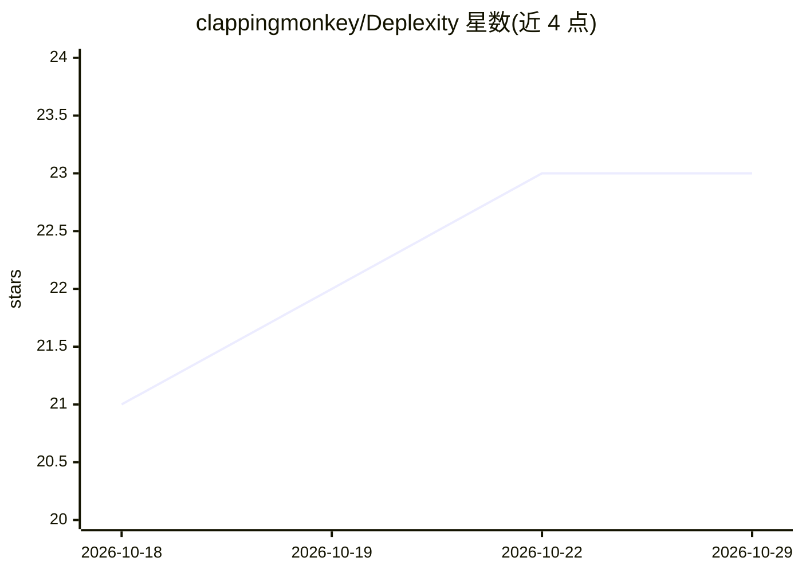

# clappingmonkey/Deplexity

⭐ 23 · Go · MIT · 推送 2026-10-28 · [GitHub](https://github.com/clappingmonkey/Deplexity) · 个人维护

**离线导出 Perplexity 对话、Spaces 与个人数据的 Go CLI**

面向 Perplexity 用户的命令行导出工具：通过浏览器会话 Cookie 登录（无需 API key），调用 Perplexity 内部 REST API 抓取全部对话线程、Spaces（含自定义指令、技能）与账户资料，输出 JSON/Markdown/PDF 三种格式。导出分两阶段并支持断点续传，PDF 渲染带指纹增量更新与超时隔离。限制：同一输出目录不支持并发导出；会话 Cookie 约 7 天过期；工具与 Perplexity 无官方关联。

## 筛选速览

| 维度 | 判定 | 备注 |
|---|---|---|
| AI 角色 | `ai-ecosystem` | LLM/agent 周边工具 |
| 许可风险 | `permissive` | MIT |
| 部署形态 | `library` | 以包/库形式分发 |
| 模型依赖 | — | README 未给出锁定关系 |
| 硬件要求 | — | 无带数字的原话,不猜 |
| 安装摩擦 | `low` | 无编译、无系统依赖或容器化 |
| 成熟度 | — | 结构信号不足 |

## 能力要点

- 浏览器会话 Cookie 认证，无需 API key，全程离线导出
- JSON/Markdown/PDF 三格式输出，PDF 由 gpdf 声明式网格渲染，无浏览器/LaTeX 依赖
- 两阶段导出（索引+详情）断点续传，PDF 指纹增量重渲染
- 单一纯 Go 静态二进制，无 CGO、零运行时依赖

## 适用场景

- 把 Perplexity 上的研究对话和 Spaces 备份为本地开放格式
- 生成带来源标注的 PDF 报告用于分享或归档
- 将导出的 JSON 接入数据管道或笔记/版本控制工作流

## 场景标签

 · 领域:AI 平台数据工具

## 证据(README 行号)

> L3: **Export your Perplexity AI conversations, spaces, and profile — fully offline, no API key required.**
> L169: 1. **Login** — Opens a real Chrome window (or uses a provided cookie). Captures the `__Secure-next-auth.session-to
> L170: 2. **Fetch** — Uses Perplexity's internal REST API with your session cookie. TLS fingerprinting matches a real Chr

## 星数曲线

2026-10-18 21 → 2026-10-29 23（+2）

---
*卡片 v1 · prompt 1.4 · 生成 2026-10-27 · 置信度 mid · 依据 README sha `55e2ae390aa3` · [字段定义](../../DATASET.md)*
