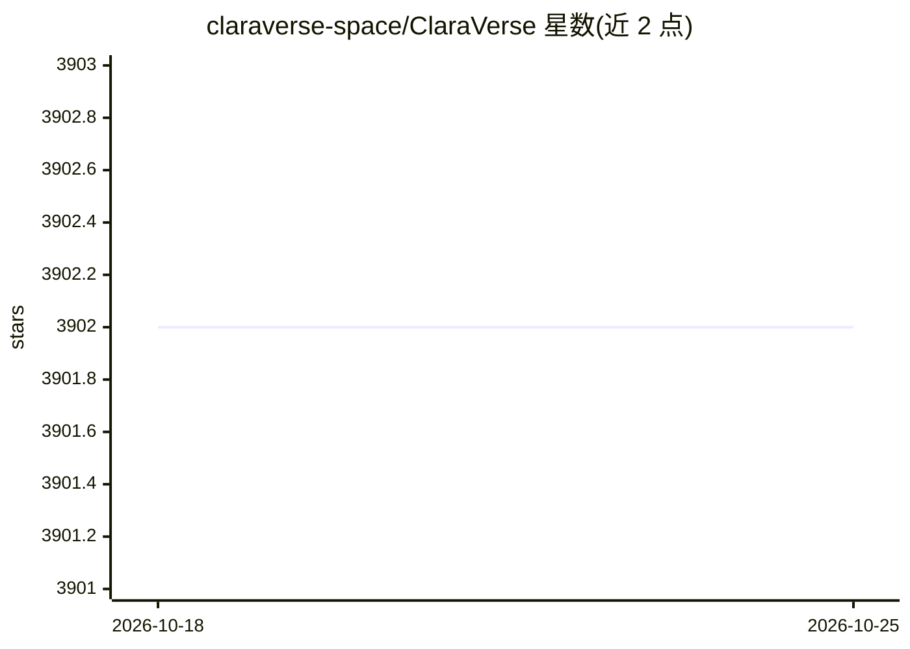

# claraverse-space/ClaraVerse

⭐ 3,902 · TypeScript · NOASSERTION · 推送 2026-08-03 · [GitHub](https://github.com/claraverse-space/ClaraVerse) · [官网](https://claraverse.space) · 组织维护

**自托管的私有 AI 工作台：聊天、多 Agent 团队与工作流**

ClaraVerse 是一个开源自托管 AI 工作区，聚合聊天、Crew 多 Agent 团队（卡片管道+人工审核）、可视化工作流构建器、分层加密记忆系统、终端编码 Agent（claracli）、Telegram 集成与知识库（向量+BM25+重排混合检索）。支持 OpenAI、Anthropic、Google、Ollama、LM Studio、llama.cpp 等 OpenAI 兼容端点，自动发现本地模型；对话默认存于本地 IndexedDB，支持 BYOK。通过 Docker Compose、单容器或 Electron 桌面应用部署，AGPL-3.0 许可。

## 筛选速览

| 维度 | 判定 | 备注 |
|---|---|---|
| AI 角色 | `ai-ecosystem` | LLM/agent 周边工具 |
| 许可风险 | `none` | NOASSERTION |
| 部署形态 | `self-host` | docker 或自建部署 |
| 模型依赖 | local-ok | 支持本地模型 |
| 硬件要求 | — | 无带数字的原话,不猜 |
| 安装摩擦 | `low` | 无编译、无系统依赖或容器化 |
| 成熟度 | — | 结构信号不足 |

## 能力要点

- Crew 多 Agent 团队，卡片管道与人工审核
- 分层记忆系统（pinned/recall），AES-256-GCM 加密，模型驱动检索
- 终端编码 Agent claracli，与 Web 应用共享账号与模型
- 自动发现 Ollama / LM Studio 本地模型，150+ 集成与 MCP 支持

## 适用场景

- 在自己服务器上搭建私有 AI 聊天与多 Agent 协作平台
- 通过可视化工作流自动化任务并接入 Slack/GitHub/Jira 等工具
- 用本地 Ollama/LM Studio 模型配合 BYOK API key 使用
- 在终端使用与 Web 账号同源的编码 Agent

## 场景标签

`多智能体` `工作流自动化` `聊天机器人` `知识库管理` · 领域:Agent 开发

## 证据(README 行号)

> L18: Chat, Crew (multi-agent teams with human review), a visual workflow builder, and Telegram integration all live in o
> L214: |**Multi-Provider**|OpenAI, Anthropic, Google, Ollama, llama.cpp, any OpenAI-compatible endpoint|
> L177: Drag-and-drop workflow builder with parallel execution, scheduling, and 200+ integrations. Describe what you need 

## 星数曲线

2026-10-18 3,902 → 2026-10-25 3,902（+0）

---
*卡片 v1 · prompt 1.4 · 生成 2026-10-21 · 置信度 high · 依据 README sha `022324f0acb4` · [字段定义](../../DATASET.md)*
