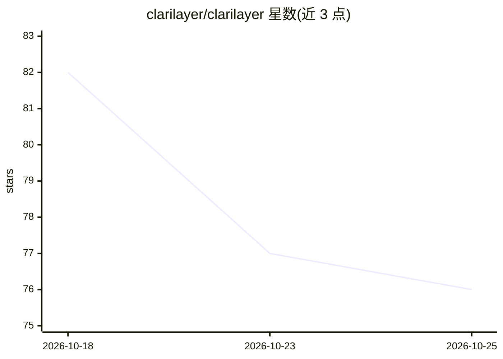

# clarilayer/clarilayer

⭐ 76 · TypeScript · NOASSERTION · 推送 2026-09-17 · [GitHub](https://github.com/clarilayer/clarilayer) · [官网](https://clarilayer.com) · 组织维护

**跨项目跨会话的 AI 记忆服务：经 MCP 保存并召回决策与规则**

ClariLayer 是一个托管 MCP 服务及配套 CLI：把用户选定的事实、偏好、决策、规则与经验保存为带来源与适用范围的记忆，供 Claude Code、Cursor、Codex、claude.ai 等 MCP 客户端在后续会话中通过 recall_context 等工具召回。支持选定历史对话的抽取导入（当前合格路径为 Claude CLI profile）、Analytics 专用工具（dbt 文档检查、定义与数仓证据比对）以及隐私边界控制（分空间、分项授权）。本仓库的文档与 CLI 为 MIT 许可，托管服务为专有；召回效果依赖客户端实际调用工具。

## 筛选速览

| 维度 | 判定 | 备注 |
|---|---|---|
| AI 角色 | `ai-ecosystem` | LLM/agent 周边工具 |
| 许可风险 | `none` | NOASSERTION |
| 部署形态 | `library` | 以包/库形式分发 |
| 模型依赖 | — | README 未给出锁定关系 |
| 硬件要求 | — | 无带数字的原话,不猜 |
| 安装摩擦 | `low` | 无编译、无系统依赖或容器化 |
| 成熟度 | `idea` | |

## 能力要点

- 记忆条目保留来源与适用范围，支持 scoped forget 与排除
- 23 个 MCP 工具：recall_context / remember / context_checkpoint / propose 等
- Analytics 路径：本地 dbt manifest/catalog 漂移检查与数仓证据比对
- 历史导入与语义搜索各自独立授权，分空间不自动合并

## 适用场景

- 让 AI 编码助手在后续会话中记住项目决策与规则
- 把选定的历史对话抽取为可召回的工作记忆
- 本地检查 dbt 文档与数仓定义的漂移并暂存发现

## 场景标签

`Agent 记忆` `语义搜索` · 领域:Agent 开发

## 证据(README 行号)

> L15: ClariLayer keeps the facts, preferences, decisions, rules and lessons you choose to carry forward. Connect Claude C
> L82: The hosted MCP service was checked on **September 17, 2026**: **capability v64 · server 0.39.0 · 23 tools**. Use th
> L76: |Recall|`recall_context` retrieves relevant saved context across the selected authorized space. Preserve source and

## 星数曲线

2026-10-18 82 → 2026-10-25 76（-6）

---
*卡片 v1 · prompt 1.4 · 生成 2026-10-24 · 置信度 high · 依据 README sha `d660e9ae6ae4` · [字段定义](../../DATASET.md)*
