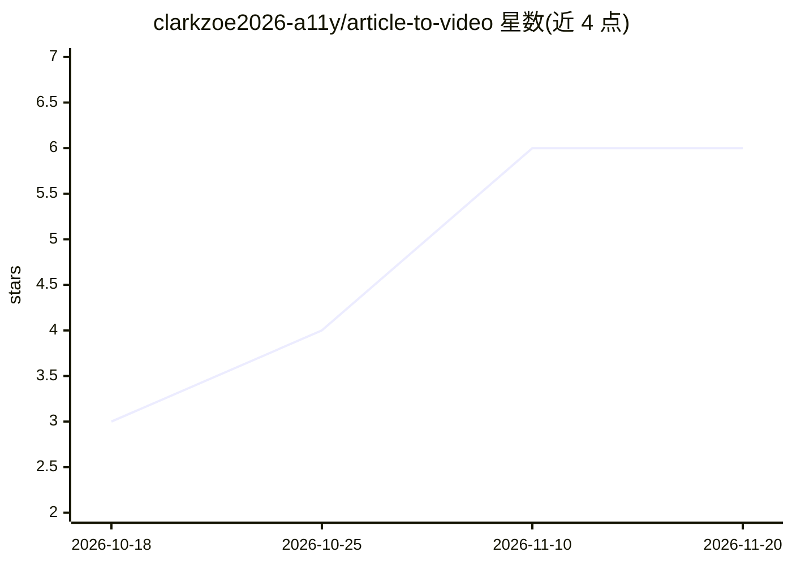

# clarkzoe2026-a11y/article-to-video

⭐ 6 · Python · MIT · 推送 2026-10-09 · [GitHub](https://github.com/clarkzoe2026-a11y/article-to-video) · 个人维护 · 中文 README

**把图文文章转成 16:9 对话讲解视频的本地工具**

article-to-video 读取飞书文档、公众号、网页或本地 Markdown 文章，将其改写为双人对话口播脚本，用 Gemini TTS 生成配音，通过 WhisperX 逐字对齐使画面随台词切换，最后用 Remotion 渲染 16:9 视频并自动生成平台章节。流程在 Claude Code、Codex、Cursor 等 AI 编程助手中以一句话驱动，也可手动运行 ./a2v 子命令。设三道人工确认关卡与自动质检（黑帧扫描、切点检查、缩略图墙）。仅支持 Mac/Linux 本地运行，依赖 Gemini API Key（免费版每天 10 次调用），占用约 3 GB 磁盘。

## 筛选速览

| 维度 | 判定 | 备注 |
|---|---|---|
| AI 角色 | `ai-native` | 本体是模型或模型工具 |
| 许可风险 | `permissive` | MIT |
| 部署形态 | `None` |  |
| 模型依赖 | — | README 未给出锁定关系 |
| 硬件要求 | — | 无带数字的原话,不猜 |
| 安装摩擦 | `low` | 无编译、无系统依赖或容器化 |
| 成熟度 | — | 结构信号不足 |

## 能力要点

- Gemini TTS 双人对话配音 + WhisperX 逐字对齐画面切换
- 自动识别截图红框，先展示全图再推近并模拟光标点击
- 脚本/配音/成片三道人工关卡，渲染前自动校验
- 支持 ./a2v fetch/voice/shots/render 等子命令手动执行

## 适用场景

- 把微信公众号文章转成讲解视频发布
- 将技术教程文章做成带命令演示的科普视频
- 为知识类内容生成配音与逐字对齐的画面

## 场景标签

`视频生成` `语音合成` · 领域:内容生成

## 证据(README 行号)

> L7: **让文章，被看见。** 把一篇图文文章，变成一支 16:9 的知识讲解视频：两个人的对话讲给观众听，你截图上的每一个红框、每一条命令，都在讲到它的那一秒出现。开源、免费、本地运行（Mac / Linux），在 Claude Cod
> L17: - **双人对话口播**：主讲（女声）+ 提问（男声），提问者替观众问出卡点；用 Gemini TTS 免费版，整片配音一次生成。
> L72: 1. **抓取文章**（`./a2v fetch`）：正文和截图一起拿下来。

## 星数曲线

2026-10-18 3 → 2026-11-20 6（+3）

---
*卡片 v1 · prompt 1.4 · 生成 2026-11-20 · 置信度 high · 依据 README sha `28c8d3c9bd80` · [字段定义](../../DATASET.md)*
