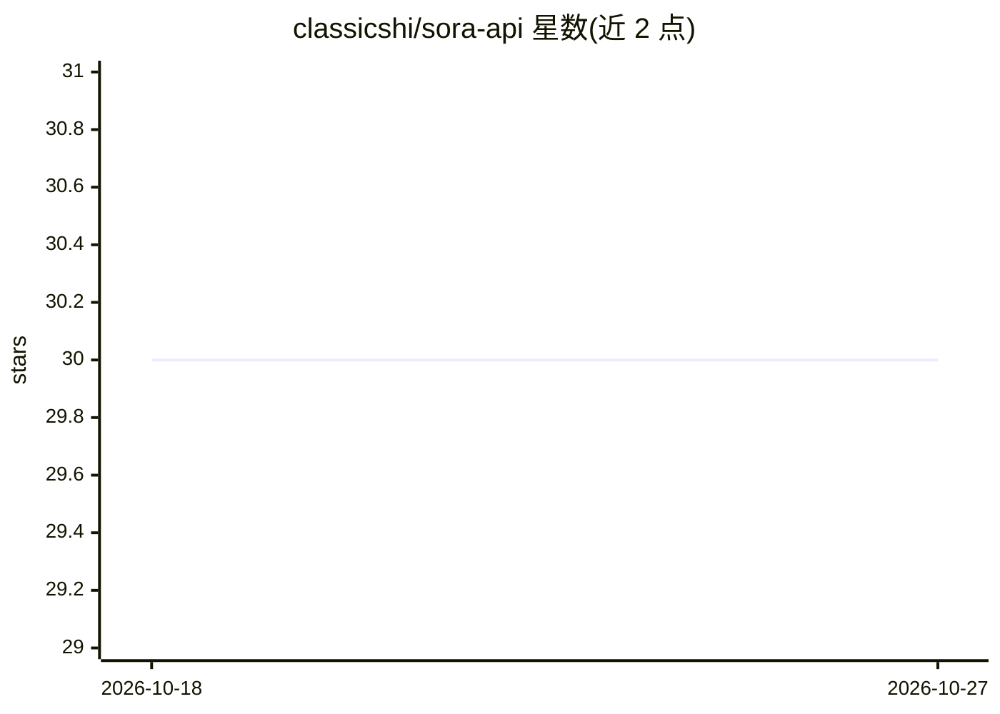

# classicshi/sora-api

⭐ 30 · Python · MIT · 推送 2025-11-24 · [GitHub](https://github.com/classicshi/sora-api) · 个人维护

**通过网页界面调用 Sora 2 API 生成 AI 视频的工具**

Sora 2 视频生成的客户端工具：用户在网页界面设置视频参数，系统将其发送至 Sora 2 API，处理完成后提供预览与下载，支持文生视频和图生视频两种模式。面向需要简便操作 Sora 2 API 的个人用户。运行需自备 Sora 2 API key、Python 3.10+、至少 4GB 内存；通过 git clone 源码安装并用 pip 安装依赖，配置 .env 后运行 main.py 启动本地 Web 界面。

## 筛选速览

| 维度 | 判定 | 备注 |
|---|---|---|
| AI 角色 | `ai-native` | 本体是模型或模型工具 |
| 许可风险 | `permissive` | MIT |
| 部署形态 | `library` | 以包/库形式分发 |
| 模型依赖 | — | README 未给出锁定关系 |
| 硬件要求 | — | 无带数字的原话,不猜 |
| 安装摩擦 | `low` | 无编译、无系统依赖或容器化 |
| 成熟度 | — | 结构信号不足 |

## 能力要点

- 网页界面配置参数并调用 Sora 2 API 生成视频
- 支持文生视频与图生视频两种模式
- 生成结果可直接预览与下载
- 跨平台支持 Windows/macOS/Linux

## 适用场景

- 在本地网页界面用 Sora 2 API 生成视频
- 从文本或图片生成视频并下载结果

## 场景标签

`视频生成` · 领域:内容生成

## 证据(README 行号)

> L6: This project is designed to simplify the process of creating Sora 2 AI videos using the API and a web interface.
> L9: The tool connects to the Sora 2 API to handle video generation requests. Users can define video parameters through a

## 星数曲线

2026-10-18 30 → 2026-10-27 30（+0）

---
*卡片 v1 · prompt 1.4 · 生成 2026-10-26 · 置信度 high · 依据 README sha `3016546113b8` · [字段定义](../../DATASET.md)*
