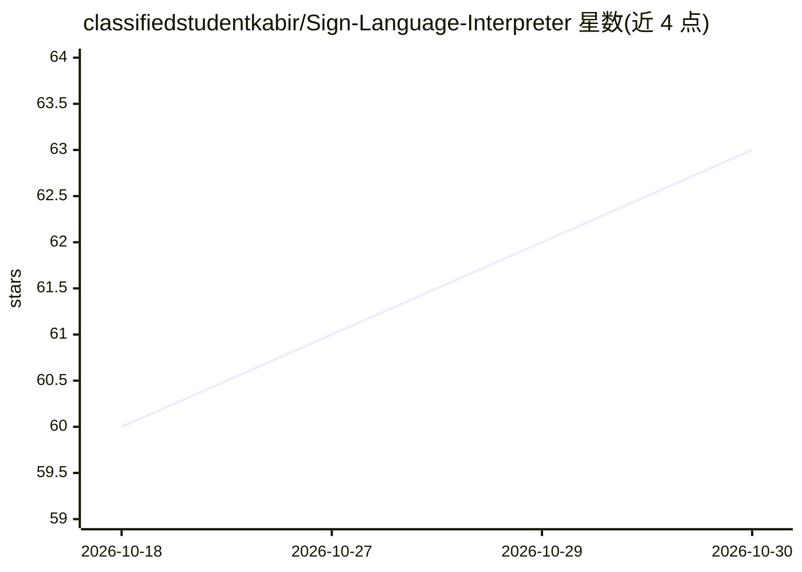

# classifiedstudentkabir/Sign-Language-Interpreter

⭐ 63 · JavaScript · 推送 2026-02-01 · [GitHub](https://github.com/classifiedstudentkabir/Sign-Language-Interpreter) · [官网](https://classifiedstudentkabir.github.io/Sign-Language-Interpreter/) · 个人维护

**在浏览器实时识别手语手势并转成文字的网页应用**

SignLens 是部署在 GitHub Pages 上的网页应用，通过 MediaPipe Hands 进行手部关键点检测，配合自定义几何分类器识别单手与双手手势（数字 0-10、常见短语如 Hello、Thank You、Help 等），并转成文字输出。所有处理在浏览器本地完成，视频数据不上传服务器；另集成语音识别支持双向交流。技术栈为原生 HTML/CSS/JavaScript，本地测试方式为克隆仓库后用浏览器打开 index.html。

## 筛选速览

| 维度 | 判定 | 备注 |
|---|---|---|
| AI 角色 | `ai-native` | 本体是模型或模型工具 |
| 许可风险 | `none` | — |
| 部署形态 | `None` |  |
| 模型依赖 | — | README 未给出锁定关系 |
| 硬件要求 | — | 无带数字的原话,不猜 |
| 安装摩擦 | `low` | 无编译、无系统依赖或容器化 |
| 成熟度 | — | 结构信号不足 |

## 能力要点

- MediaPipe Hands 手部关键点检测 + 自定义几何分类器
- 支持单手与双手手势识别（数字与常见短语）
- 全部处理在浏览器本地进行，视频数据不上传服务器
- 集成语音识别支持双向交流

## 适用场景

- 在浏览器中实时识别手语手势并转成文字
- 听障人士与他人的辅助沟通
- 无障碍与包容性教育场景使用

## 场景标签

`语音识别` `目标检测` · 领域:感知与多模态

## 证据(README 行号)

> L1: # SignLens - AI-Based Sign Language Interpreter
> L3: A real-time web application that interprets sign language gestures using computer vision and machine learning (Media
> L11: - **Real-Time Hand Tracking:** Uses MediaPipe Hands for high-performance hand landmark detection.

## 星数曲线

2026-10-18 60 → 2026-10-30 63（+3）

---
*卡片 v1 · prompt 1.4 · 生成 2026-10-24 · 置信度 high · 依据 README sha `f7e38ddfe2eb` · [字段定义](../../DATASET.md)*
