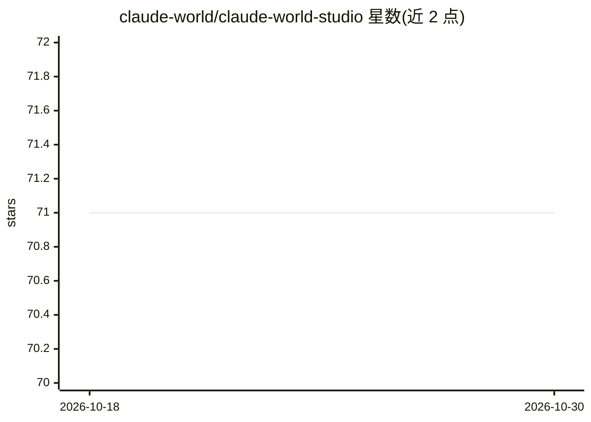

# claude-world/claude-world-studio

⭐ 71 · TypeScript · MIT · 推送 2026-10-22 · [GitHub](https://github.com/claude-world/claude-world-studio) · 组织维护 · 中文 README

**面向 Threads 的 AI 内容流水线：趋势发现到自动发布**

基于 Claude Agent SDK 与 MCP 的内容生产应用：通过 trend-pulse（20 个趋势源）、cf-browser、notebooklm 三个 MCP 服务器执行趋势发现、研究、来源核验、打分与 Threads 发布。支持多账号人设、cron 定时任务、SQLite FTS5 长期记忆、目标状态机与 Agent 仪表盘，内置 5 维度质量门控（总分 ≥70）。提供 npm 全局安装、macOS 桌面安装包（Electron 44，Apple Silicon 需 macOS 13+）与源码运行三种方式，需 Node.js 20.19+ 与 Claude 凭证，MCP 服务器全部可选。

## 筛选速览

| 维度 | 判定 | 备注 |
|---|---|---|
| AI 角色 | `ai-native` | 本体是模型或模型工具 |
| 许可风险 | `permissive` | MIT |
| 部署形态 | `desktop` | 安装包/桌面程序 |
| 模型依赖 | locked-api |  |
| 硬件要求 | — | 无带数字的原话,不猜 |
| 安装摩擦 | `medium` | 含编译或系统依赖之一 |
| 成熟度 | — | 结构信号不足 |

## 能力要点

- 三个 MCP 服务器：trend-pulse / cf-browser / notebooklm，可任意组合或省略
- Threads 多账号矩阵发布，支持 14 种帖子类型与 5 维度质量门控
- SQLite FTS5 长期记忆、目标状态机与 REST API（/api/agent/*）
- macOS 桌面安装包、npm 全局安装与 CLI（23 个命令）三种交付形式

## 适用场景

- 自动发现热点、调研并生成内容发布到 Threads
- 多账号以不同人设对同一话题矩阵化发文
- cron 定时任务无人值守或人工审核后发布

## 场景标签

`AI 写作` `工作流自动化` `Agent 记忆` · 领域:Agent 开发

## 证据(README 行号)

> L8: AI-powered content pipeline: from trend discovery to social publishing.
> L10: Built with **Claude Agent SDK + MCP** (Model Context Protocol), featuring 3 integrated MCP servers for real-time tr
> L168: |AI Model|Claude Opus 5.5 for chat (`opus` alias), Sonnet 5.5 for scheduled tasks (`sonnet` alias)|

## 星数曲线

2026-10-18 71 → 2026-10-30 71（+0）

---
*卡片 v1 · prompt 1.4 · 生成 2026-10-24 · 置信度 high · 依据 README sha `77f197b66ae3` · [字段定义](../../DATASET.md)*
