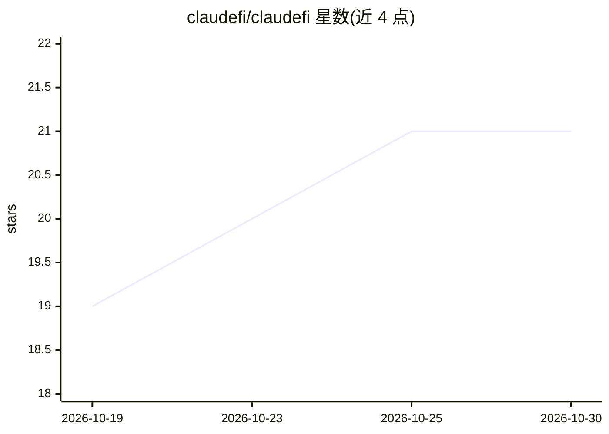

# claudefi/claudefi

⭐ 21 · TypeScript · 推送 2026-01-11 · [GitHub](https://github.com/claudefi/claudefi) · [官网](https://claudefi.com) · 组织维护

**开源 Claude 交易 Agent：自主在多链 DeFi 市场循环交易并学习**

基于 Claude Agent SDK 构建的自主 DeFi 交易 Agent，运行 30 分钟一次的 Ralph 循环（观察-思考-行动-学习），在 Meteora DLMM、Hyperliquid 永续、Jupiter 现货与 Polymarket 预测市场四个领域并行执行子 Agent 交易。每笔交易结果写入带 TTL 的记忆系统（警告 60 天、模式 90 天，相似度 70% 合并，成功率低于 30% 的模式剪枝）。内置回撤限制、仓位上限、大额人工审批等风控钩子；默认纸面交易。本地运行，需 ANTHROPIC_API_KEY，文档称成本约 $13/天。

## 筛选速览

| 维度 | 判定 | 备注 |
|---|---|---|
| AI 角色 | `ai-native` | 本体是模型或模型工具 |
| 许可风险 | `permissive` | — |
| 部署形态 | `None` |  |
| 模型依赖 | locked-api |  |
| 硬件要求 | — | 无带数字的原话,不猜 |
| 安装摩擦 | `low` | 无编译、无系统依赖或容器化 |
| 成熟度 | — | 结构信号不足 |

## 能力要点

- 30 分钟循环：观察→思考→行动→学习，四域并行子 Agent
- 自改进记忆系统：TTL 过期、相似合并、低成功率剪枝
- 风控基础设施：全局 -15% 回撤熔断、单笔 >$500 需人工审批
- 支持 Claude Code skills 扩展策略与领域知识

## 适用场景

- 让 Agent 全天候在 Solana/Hyperliquid/Polymarket 执行交易策略
- 用社区或自写 skills 定制交易策略与风控规则
- 默认纸面交易模式下测试策略，再切换实盘

## 场景标签

`金融量化` · 领域:学习与行业

## 证据(README 行号)

> L7: **the open source claude agent that learns to trade defi**
> L15: claudefi runs a continuous 30-minute loop—observing markets, making decisions, executing trades, and building memor
> L61: 2. Run parallel Claude subagents (one per domain)

## 星数曲线

2026-10-19 19 → 2026-10-30 21（+2）

---
*卡片 v1 · prompt 1.4 · 生成 2026-10-28 · 置信度 high · 依据 README sha `3a6a0acae758` · [字段定义](../../DATASET.md)*
