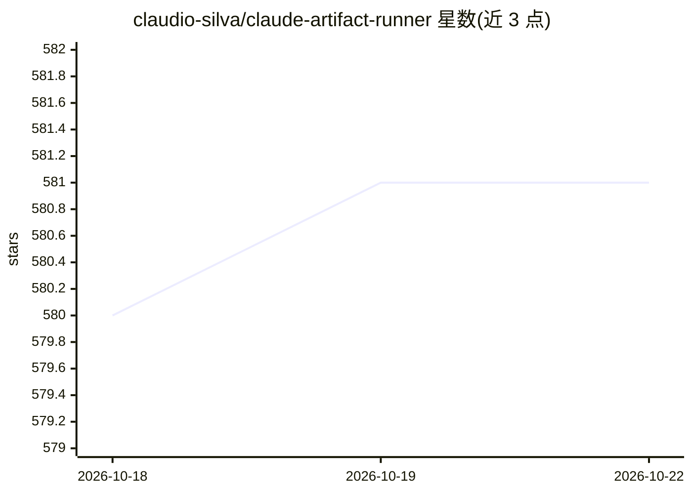

# claudio-silva/claude-artifact-runner

⭐ 581 · TypeScript · MIT · 推送 2026-01-23 · [GitHub](https://github.com/claudio-silva/claude-artifact-runner) · 个人维护

**把 Claude 生成的 Artifact 一键运行/构建为可部署 React 应用**

面向使用 Claude Artifacts 的开发者的零配置 npx 工具与项目模板：将下载的 .tsx/.jsx Artifact 在数秒内于本地开发服务器运行、构建为单文件或多文件 HTML 产物、或创建含 React 18/TypeScript/Vite/Tailwind/Shadcn UI 的完整可编辑工程，并可组合多个 Artifact 为多页应用（文件路由）。另提供 Docker 镜像用于免装 Node.js 或 CI/CD 场景。限制：仅覆盖客户端交互式 Web 应用，不支持 Mermaid/SVG 等文档型 Artifact，不含后端。

## 筛选速览

| 维度 | 判定 | 备注 |
|---|---|---|
| AI 角色 | `ai-ecosystem` | LLM/agent 周边工具 |
| 许可风险 | `permissive` | MIT |
| 部署形态 | `self-host` | docker 或自建部署 |
| 模型依赖 | — | README 未给出锁定关系 |
| 硬件要求 | — | 无带数字的原话,不猜 |
| 安装摩擦 | `low` | 无编译、无系统依赖或容器化 |
| 成熟度 | — | 结构信号不足 |

## 能力要点

- npx run-claude-artifact 一条命令运行/构建/创建完整工程
- 单文件构建产出可部署到任意静态托管的 HTML（含 favicon）
- 预置与 Claude Artifacts 环境一致的库：React 18/Vite/Shadcn UI/Tailwind/Recharts/Three.js
- 提供 Docker 镜像，容器内自动克隆模板，无需宿主机装 git

## 适用场景

- 把 Claude 生成的 Artifact 在本地快速跑起来或部署上线
- 以 Artifact 为起点继续开发完整 React 项目
- 在 CI/CD 流水线中自动构建 Artifact 产物

## 场景标签

 · 领域:前端开发工具/AI 生成代码交付

## 证据(README 行号)

> L7: Zero‑config `npx` tool, project template, and optional Docker image, to **run**, **build**, or **create** full proje
> L29: Artifacts are interactive web applications created by Claude AI, and they are a great way to get started with web d
> L33: Claude already provides both **Copy** and **Download** buttons for you to get the Artifact code, but it **does not 

## 星数曲线

2026-10-18 580 → 2026-10-22 581（+1）

---
*卡片 v1 · prompt 1.4 · 生成 2026-10-21 · 置信度 high · 依据 README sha `c181a3cd0ec0` · [字段定义](../../DATASET.md)*
