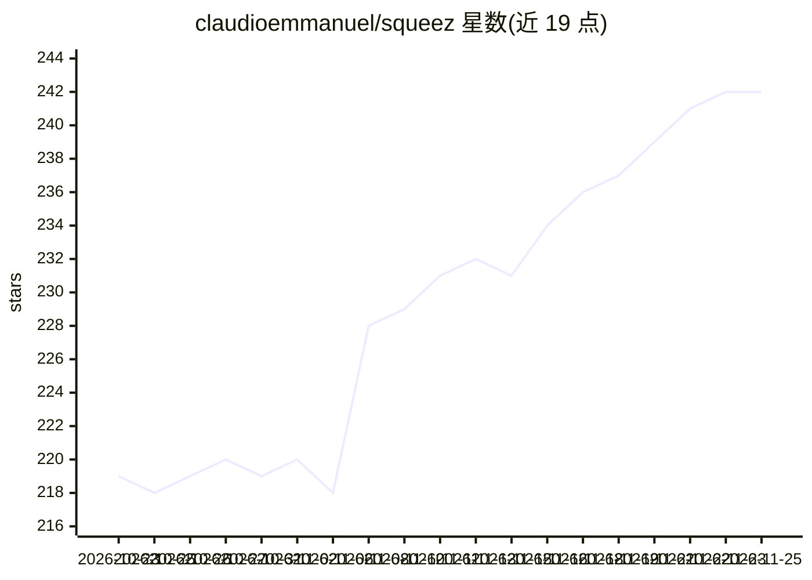

# claudioemmanuel/squeez

⭐ 242 · Rust · Apache-2.0 · 推送 2026-11-23 · [GitHub](https://github.com/claudioemmanuel/squeez) · 个人维护

**为 7 个 AI 编码 CLI 压缩工具输出的 token 节省器**

以 hook 方式嵌入 Claude Code、Copilot CLI、OpenCode、Gemini CLI、Codex CLI、Pi、Hermes 七个 agent CLI，在模型读取前压缩命令输出、重复读取、截图与重复结果：60+ 程序处理器、41 条过滤器规则、MinHash 跨调用去重、超 500 行输出转摘要。压缩可逆（squeez_retrieve 取回），拒绝净亏损改写，出错时回退为原始输出。单个静态 Rust 二进制，零运行时依赖，提供 MCP 只读工具与会话记忆。

## 筛选速览

| 维度 | 判定 | 备注 |
|---|---|---|
| AI 角色 | `ai-ecosystem` | LLM/agent 周边工具 |
| 许可风险 | `permissive` | Apache-2.0 |
| 部署形态 | `desktop` | 安装包/桌面程序 |
| 模型依赖 | locked-api |  |
| 硬件要求 | — | 无带数字的原话,不猜 |
| 安装摩擦 | `medium` | 含编译或系统依赖之一 |
| 成熟度 | — | 结构信号不足 |

## 能力要点

- hook 嵌入 7 个 agent CLI，压缩 bash 输出/重复读取/截图
- 压缩可逆：squeez_retrieve 取回被丢弃内容，按语义搜索 stash
- 自适应强度随上下文占用切换（80% 阈值），squeez receipt 统计节省 token 与费用
- 过滤器 DSL 带 test_input/test_expect，安装前跑测试

## 适用场景

- AI 编码 CLI 长会话中减少上下文占用与 API 费用
- 团队用 squeez export 汇总 token 节省指标到自有后端
- 为特定程序编写自定义输出压缩过滤规则

## 场景标签

 · 领域:开发者工具/LLM 上下文管理

## 证据(README 行号)

> L14: It sits in the hooks of seven agent CLIs (Claude Code, GitHub Copilot CLI, OpenCode, Gemini CLI, OpenAI Codex CLI, 
> L12: **squeez decides what tool output reaches your AI coding agent's context — and shows you what that saved.**

## 星数曲线

2026-10-23 219 → 2026-11-25 242（+23）

---
*卡片 v1 · prompt 1.4 · 生成 2026-11-25 · 置信度 high · 依据 README sha `e9970b01aa52` · [字段定义](../../DATASET.md)*
