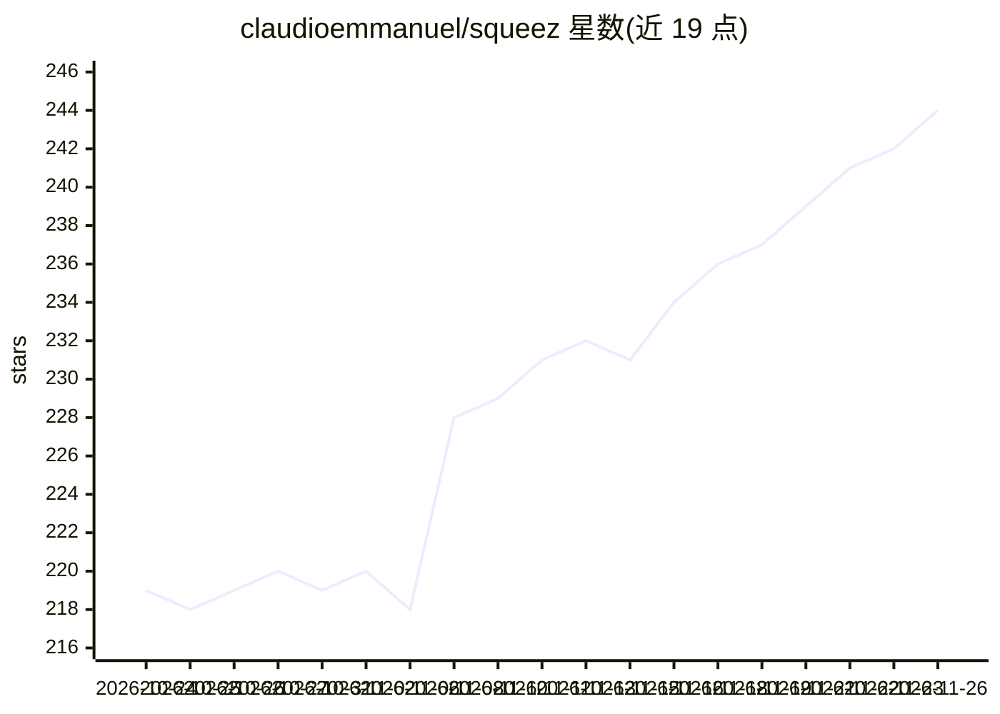

# claudioemmanuel/squeez

⭐ 244 · Rust · Apache-2.0 · 推送 2026-11-24 · [GitHub](https://github.com/claudioemmanuel/squeez) · 个人维护

**为 7 个 AI 编码 CLI 压缩工具输出以节省上下文 token 的 hook 工具**

以 hook 形式接入 Claude Code、Copilot CLI、OpenCode、Gemini CLI、Codex CLI、Pi、Hermes 七个 agent CLI，在模型读取前压缩命令输出、重复读取、截图与重复结果。压缩可逆（被丢弃内容可用 squeez_retrieve 取回），内置净损失守卫与 fail-open 机制。单个静态 Rust 二进制，零运行时依赖，提供 18 个只读 MCP 工具、会话记忆、自适应压缩强度与 token/费用统计报告。部分 host 对 Read/Grep 限流仅软支持（依赖 GEMINI.md/AGENTS.md）。

## 筛选速览

| 维度 | 判定 | 备注 |
|---|---|---|
| AI 角色 | `ai-ecosystem` | LLM/agent 周边工具 |
| 许可风险 | `permissive` | Apache-2.0 |
| 部署形态 | `desktop` | 安装包/桌面程序 |
| 模型依赖 | — | README 未给出锁定关系 |
| 硬件要求 | — | 无带数字的原话,不猜 |
| 安装摩擦 | `medium` | 含编译或系统依赖之一 |
| 成熟度 | — | 结构信号不足 |

## 能力要点

- 以 hook 接入 7 个 AI 编码 CLI，压缩命令输出、重读与截图
- 60+ 程序处理器、41 条内置过滤规则与自定义 DSL 规则（含测试样例）
- 压缩可逆：squeez_retrieve 可展开被丢弃内容，按语义检索 stash
-  squeez receipt 统计节省 token 与费用，支持 JSON/OTLP 导出

## 适用场景

- 为多个 AI 编码 CLI 减少上下文窗口占用
- 团队统计 agent 会话的 token 消耗与成本
- 让子 agent 并发调用有开销上限与独立计数

## 场景标签

 · 领域:开发者工具/LLM 上下文管理

## 证据(README 行号)

> L14: It sits in the hooks of seven agent CLIs (Claude Code, GitHub Copilot CLI, OpenCode, Gemini CLI, OpenAI Codex CLI, 
> L114: `claude mcp add squeez -- ~/.claude/squeez/bin/squeez mcp` exposes 18 read-only tools: `squeez_retrieve` and `sque

## 星数曲线

2026-10-24 219 → 2026-11-26 244（+25）

---
*卡片 v1 · prompt 1.4 · 生成 2026-11-26 · 置信度 high · 依据 README sha `1531235b3d67` · [字段定义](../../DATASET.md)*
