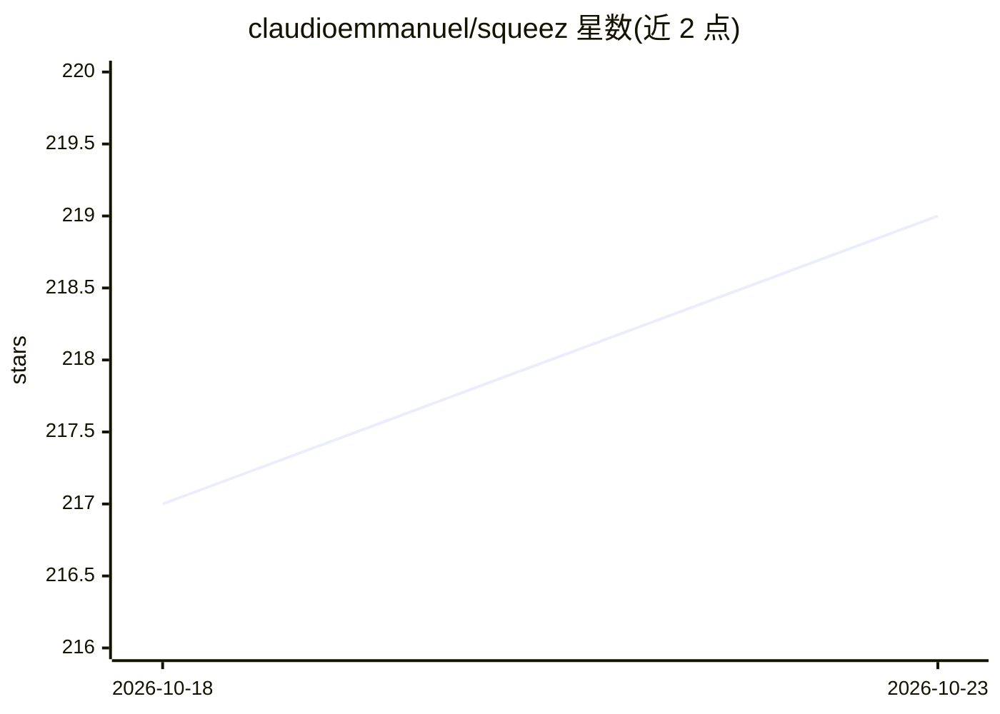

# claudioemmanuel/squeez

⭐ 219 · Rust · Apache-2.0 · 推送 2026-10-19 · [GitHub](https://github.com/claudioemmanuel/squeez) · 个人维护

**给 AI 编程 CLI 用户的 hook 式 token 压缩器**

面向 Claude Code、Copilot CLI、OpenCode、Gemini CLI、Codex CLI、Pi、Hermes 七种 AI CLI 宿主的可执行工具：通过 PreToolUse hook 拦截 bash 输出，经内置过滤器、跨调用去重、日志模板合并与相关性截断压缩至最多 95%，压缩原文以内容寻址 blob 暂存并可通过 squeez_retrieve MCP 工具取回；附带 41 条内置过滤规则、git status porcelain 原生路径、净收益门槛与标识符保留机制。Rust 编写，零运行时依赖，安装后自动检测并注册到已装宿主。Windows 下 curl 安装需 Git Bash。

## 筛选速览

| 维度 | 判定 | 备注 |
|---|---|---|
| AI 角色 | `ai-ecosystem` | LLM/agent 周边工具 |
| 许可风险 | `permissive` | Apache-2.0 |
| 部署形态 | `desktop` | 安装包/桌面程序 |
| 模型依赖 | locked-api |  |
| 硬件要求 | — | 无带数字的原话,不猜 |
| 安装摩擦 | `high` | 编译与系统依赖俱全 |
| 成熟度 | — | 结构信号不足 |

## 能力要点

- PreToolUse hook 拦截 bash 输出，最多压缩 95%，原文暂存可经 MCP 工具取回
- 支持 7 个 AI CLI 宿主，squeez setup 自动检测并注册 hook
- 41 条内置过滤 DSL 规则 + git status porcelain 原生处理路径
- MCP server 暴露 17 个工具供 MCP 兼容 LLM 查询会话记忆

## 适用场景

- 降低 AI CLI 编程会话的 bash 输出 token 消耗
- 长日志/构建输出压缩后仍可取回原始内容
- 跨调用去重避免重复输出占用上下文窗口

## 场景标签

 · 领域:LLM 基础设施/上下文工程

## 证据(README 行号)

> L12: End-to-end token optimizer for seven AI CLI hosts — Claude Code, GitHub Copilot CLI, OpenCode, Gemini CLI, OpenAI C
> L63: `squeez setup` auto-detects every CLI present on disk and registers the hooks. `squeez uninstall` removes them. Ses
> L116: |**MCP server**|`squeez mcp` runs a JSON-RPC 2.0 server over stdio exposing 17 tools (16 read-only session-memory 

## 星数曲线

2026-10-18 217 → 2026-10-23 219（+2）

---
*卡片 v1 · prompt 1.4 · 生成 2026-10-22 · 置信度 mid · 依据 README sha `bbdff0bdcf89` · [字段定义](../../DATASET.md)*
