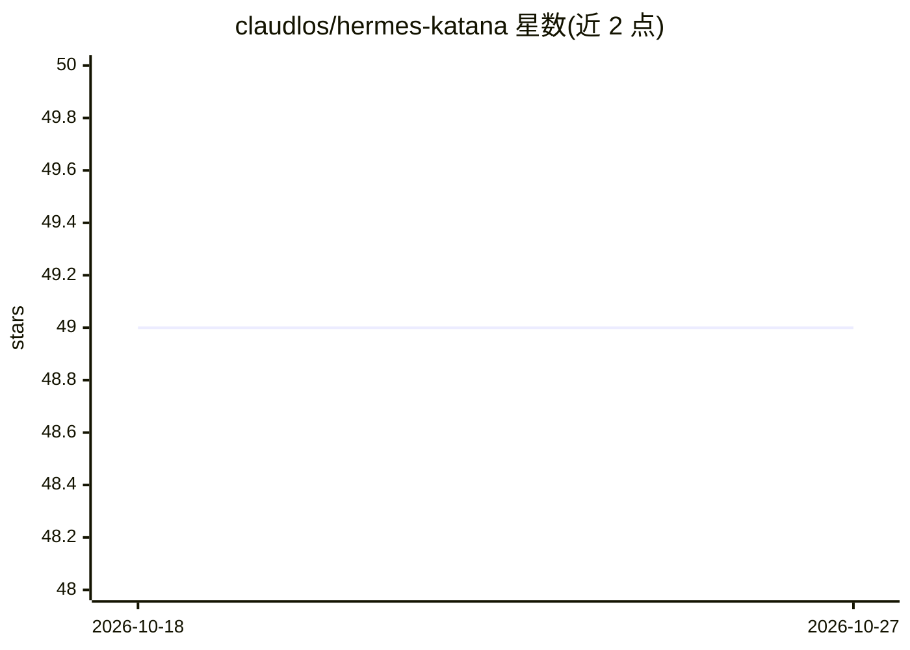

# claudlos/hermes-katana

⭐ 49 · Python · MIT · 推送 2026-10-26 · [GitHub](https://github.com/claudlos/hermes-katana) · [官网](https://claudlos.github.io/hermes-katana/) · 个人维护

**给 AI agent 开发者的纵深防御安全工具包：污点追踪、策略引擎与红队基准**

面向 AI agent 的安全防护层：对文本做字符级来源（污点）追踪，扫描解码内容中的提示注入、危险命令与密钥，在工具调用前执行 YAML 声明式策略（含人工审批升级），出站流量经 mitmproxy 代理剥离密钥，决策记录进 SHA-256 哈希链审计日志。附带 Proving Ground 多模型攻击测试框架与在 Hugging Face 发布的 MIT 许可注入分类器（MiniLM 蒸馏/DeBERTa-v3-large），并附论文。默认小体积安装，无需模型下载；提供 CLI 安装命令。

## 筛选速览

| 维度 | 判定 | 备注 |
|---|---|---|
| AI 角色 | `ai-ecosystem` | LLM/agent 周边工具 |
| 许可风险 | `permissive` | MIT |
| 部署形态 | `library` | 以包/库形式分发 |
| 模型依赖 | — | README 未给出锁定关系 |
| 硬件要求 | — | 无带数字的原话,不猜 |
| 安装摩擦 | `low` | 无编译、无系统依赖或容器化 |
| 成熟度 | — | 结构信号不足 |

## 能力要点

- 字符级污点追踪（受 CaMeL 启发），8 类来源标签
- 声明式 YAML 策略引擎，三种内置预设与热重载
- 30+ 注入模式、15+ 密钥模式、40+ 危险命令模式扫描
- Proving Ground 攻击基准：17,643 条攻击池、16 种模型/harness 组合、11 种语言多语测试

## 适用场景

- 给 agent 的工具调用加策略门控与人工审批
- 防止提示注入与密钥经出站流量泄漏
- 对自家 agent 做多模型攻击有效性红队测试

## 场景标签

`网络安全` `模型评测` · 领域:评测与运维

## 证据(README 行号)

> L14: Hermes Katana is a defense-in-depth security layer for AI agents. It tracks
> L16: commands, applies YAML policies before tool dispatch, scrubs outbound secrets,
> L25: - Runtime policy decisions for clean, tainted, dangerous, and unknown tool calls

## 星数曲线

2026-10-18 49 → 2026-10-27 49（+0）

---
*卡片 v1 · prompt 1.4 · 生成 2026-10-24 · 置信度 high · 依据 README sha `c3815ec56973` · [字段定义](../../DATASET.md)*
