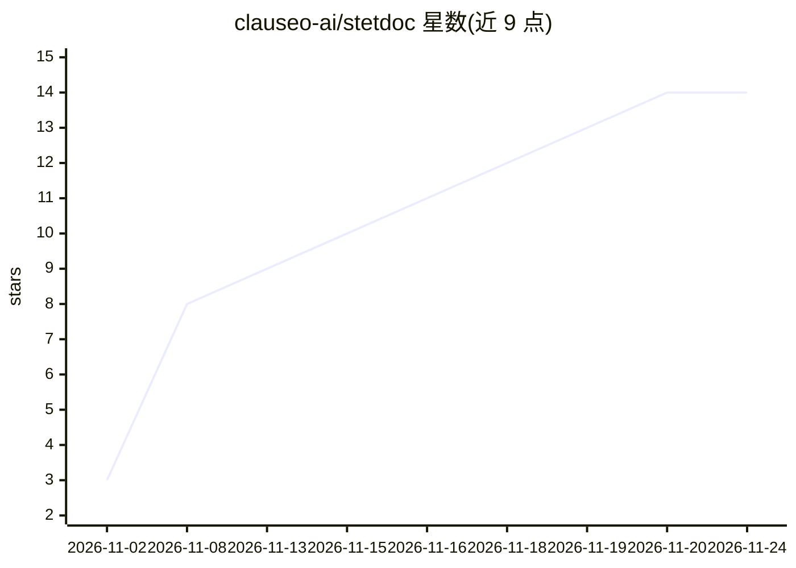

# clauseo-ai/stetdoc

⭐ 14 · Rust · Apache-2.0 · 推送 2026-11-18 · [GitHub](https://github.com/clauseo-ai/stetdoc) · [官网](https://stetdoc.clauseo.chat) · 组织维护

**让 AI agent 以修订模式编辑 Word .docx 的 CLI/MCP 工具**

stetdoc 提供 CLI、MCP 服务器与库三种形态，供 AI agent 编辑 Word 文档：每次修改以 tracked change 落盘并标注作者署名。写入前按 OOXML schema 与 Word 规则校验，批量编辑要么全部应用要么整体拒绝；对多匹配、缺文本、段落已变更的情况拒绝写入并逐条列出。支持按条款编号定位、字节级往返保真、unpack/pack 工作副本流程，并通过 stetdoc init 为多种 agent 安装技能。安装渠道覆盖 Homebrew、npm、uv、pipx 与安装脚本。

## 筛选速览

| 维度 | 判定 | 备注 |
|---|---|---|
| AI 角色 | `ai-ecosystem` | LLM/agent 周边工具 |
| 许可风险 | `permissive` | Apache-2.0 |
| 部署形态 | `library` | 以包/库形式分发 |
| 模型依赖 | — | README 未给出锁定关系 |
| 硬件要求 | — | 无带数字的原话,不猜 |
| 安装摩擦 | `low` | 无编译、无系统依赖或容器化 |
| 成熟度 | `idea` | |

## 能力要点

- 每次编辑以 Word tracked change 落盘并记录作者署名
- 写入前 schema 校验，批量编辑全量应用或全量拒绝
- 字节级往返保真：未编辑时输出与输入逐字节一致
- 通过 stetdoc init 为 Claude Code、Codex、Cursor 等十余种 agent 安装技能，并提供 MCP 服务器

## 适用场景

- 让 AI agent 修改合同等 Word 文档且保留可审阅的修订记录
- 律师按条款编号（如 11.1）定位并替换文本
- 将 docx 编辑能力以 MCP 形式接入支持工具调用的 agent
- 以 Rust crate 或 npm 包把 docx 编辑引擎嵌入自有产品

## 场景标签

 · 领域:办公文档处理/legaltech

## 证据(README 行号)

> L3: stetdoc is how AI agents work in Word. Every change your agent makes lands in Word as a tracked change with its name
> L129: Agents that take tools instead of a shell get the same commands over the Model Context Protocol from `stetdoc mcp`
> L118: `stetdoc init` installs the skill for the agents you pick, or for the ones it detects. It knows Claude Code, Codex

## 星数曲线

2026-11-02 3 → 2026-11-24 14（+11）

---
*卡片 v1 · prompt 1.4 · 生成 2026-11-18 · 置信度 high · 依据 README sha `6c91a2f6f718` · [字段定义](../../DATASET.md)*
