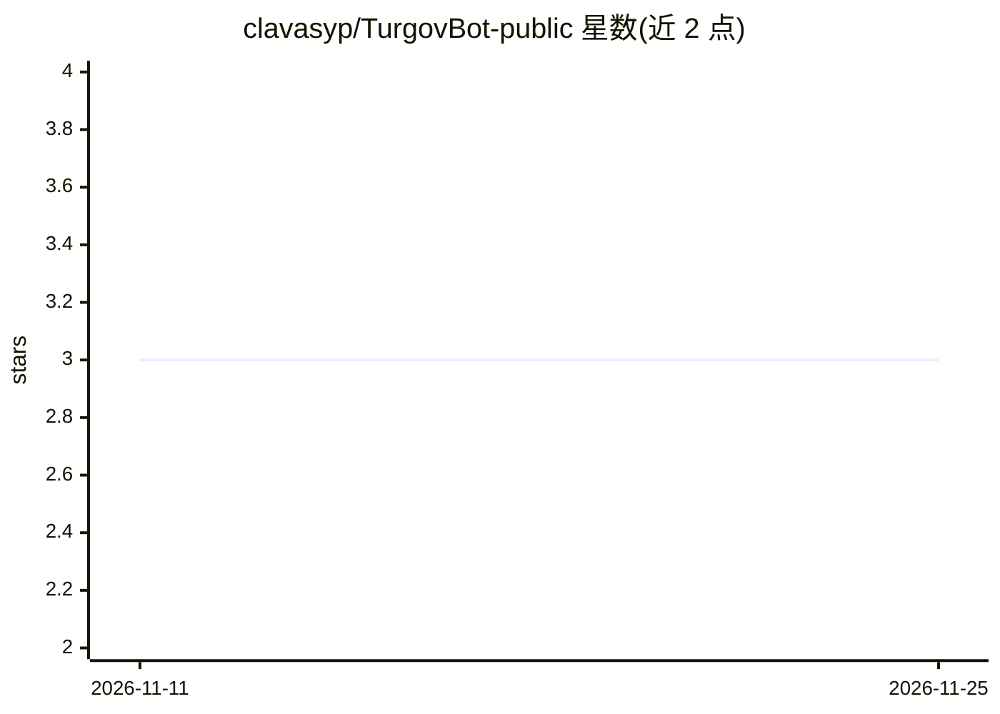

# clavasyp/TurgovBot-public

⭐ 3 · Python · MIT · 推送 2026-11-09 · [GitHub](https://github.com/clavasyp/TurgovBot-public) · [官网](https://t.me/turgovovka) · 个人维护

**面向俄语 GTA5 角色扮演服务器的 Telegram 法律助手与 API**

Telegram 机器人与后端 API，为 Majestic RP、GTA5RP 等俄语 GTA5 角色扮演项目提供法律帮助：从各服务器论坛解析法律文本，经路由模型选择法典后由 Gemini 引用条文作答；文章搜索采用无 LLM 的混合检索（PostgreSQL 全文、trigram、俚语词典、FRIDA 向量经 pgvector、加权 RRF）。另支持投诉与诉讼文书起草、角色扮演法律助手、语音提问、设备登录 API。全部服务经 Docker Compose 部署，依赖 GCP Vertex AI 项目与 BotFather 机器人。

## 筛选速览

| 维度 | 判定 | 备注 |
|---|---|---|
| AI 角色 | `ai-native` | 本体是模型或模型工具 |
| 许可风险 | `permissive` | MIT |
| 部署形态 | `self-host` | docker 或自建部署 |
| 模型依赖 | — | README 未给出锁定关系 |
| 硬件要求 | — | 无带数字的原话,不猜 |
| 安装摩擦 | `low` | 无编译、无系统依赖或容器化 |
| 成熟度 | — | 结构信号不足 |

## 能力要点

- 路由模型选法典 + Gemini 全文阅读并引用条文作答
- 无 LLM 运行时的混合文章搜索：PostgreSQL FTS + trigram + FRIDA 向量 + 加权 RRF
- 语音提问（Google Speech-to-Text）与 device-code/JWT 设备登录 API
- Docker Compose 一键编排 bot/API/worker/pgvector/Caddy 等 8 个服务

## 适用场景

- 玩家按服务器查询法律条文并获取带引用的回答
- 起草投诉、诉讼等角色扮演流程文书
- 桌面悬浮层调用文章搜索 API

## 场景标签

`RAG` `文档问答` `聊天机器人` · 领域:对话与助手

## 证据(README 行号)

> L8: *A Telegram bot and backend API that acts as a legal assistant for Russian-speaking
> L15:  выбирает нужные кодексы, Gemini (Vertex AI) отвечает по ним со ссылками на статьи.
> L17:  PostgreSQL, триграммы, словарь сленга и синонимов, векторы локальной модели

## 星数曲线

2026-11-11 3 → 2026-11-25 3（+0）

---
*卡片 v1 · prompt 1.4 · 生成 2026-11-22 · 置信度 mid · 依据 README sha `2e18b886853a` · [字段定义](../../DATASET.md)*
