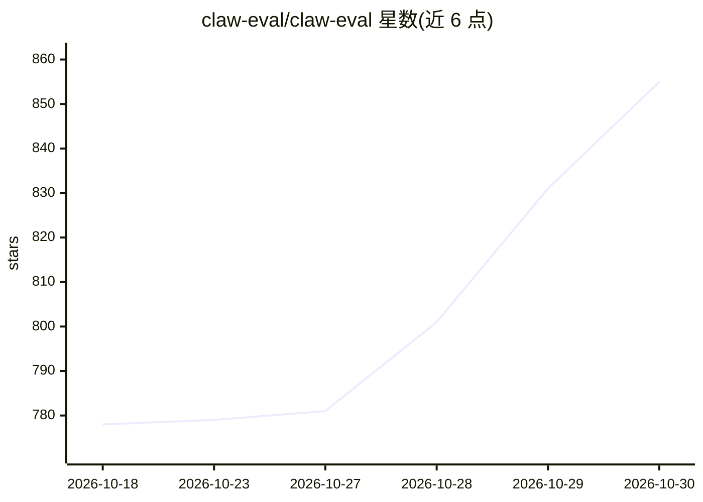

# claw-eval/claw-eval

⭐ 855 · Python · MIT · 推送 2026-10-29 · [GitHub](https://github.com/claw-eval/claw-eval) · [官网](https://claw-eval.github.io) · 组织维护 · 中文 README

**面向 LLM 自主 agent 的人工核验评测基准（300 任务）**

评测 harness 与数据集：300 个人工核验任务、2,159 条评分规则，分 general/multimodal/multi_turn 三个子集、9 个类别，从中英文查询考察 agent 的完成度、安全性与鲁棒性。采用 Pass^3 方法（三独立试验全部达标才算通过），提供沙箱批量运行 CLI，排行榜托管在 claw-eval.github.io，完整数据与 fixtures 发布于 Hugging Face。由北大/港大团队维护，另有 EvalScope 集成支持 OpenAI 兼容端点运行。

## 筛选速览

| 维度 | 判定 | 备注 |
|---|---|---|
| AI 角色 | `ai-ecosystem` | LLM/agent 周边工具 |
| 许可风险 | `permissive` | MIT |
| 部署形态 | `library` | 以包/库形式分发 |
| 模型依赖 | — | README 未给出锁定关系 |
| 硬件要求 | — | 无带数字的原话,不猜 |
| 安装摩擦 | `low` | 无编译、无系统依赖或容器化 |
| 成熟度 | — | 结构信号不足 |

## 能力要点

- 300 个人工核验任务、2,159 条 rubrics、9 类别
- Pass^3 方法：三次独立试验全部达标方计通过
- 完成度/安全性/鲁棒性三维度全轨迹审计
- 数据集与 fixtures 发布于 Hugging Face（claw-eval/Claw-Eval）

## 适用场景

- 评测自己模型或 agent 的通用自主能力并提交排行榜
- 用 Pass^3 方法学做可复现的 agent 对比实验
- 以 OpenAI 兼容端点通过 EvalScope 运行本基准

## 场景标签

`模型评测` · 领域:评测与运维

## 证据(README 行号)

> L13: > Claw-Eval: Towards Trustworthy Evaluation of Autonomous Agents.
> L60: Agents are graded on three dimensions through full-trajectory auditing:
> L32: * **Primary Metric: Pass^3.** To eliminate "lucky runs," a model must now consistently pass a task across **three i

## 星数曲线

2026-10-18 778 → 2026-10-30 855（+77）

---
*卡片 v1 · prompt 1.4 · 生成 2026-10-22 · 置信度 mid · 依据 README sha `629f7435f283` · [字段定义](../../DATASET.md)*
