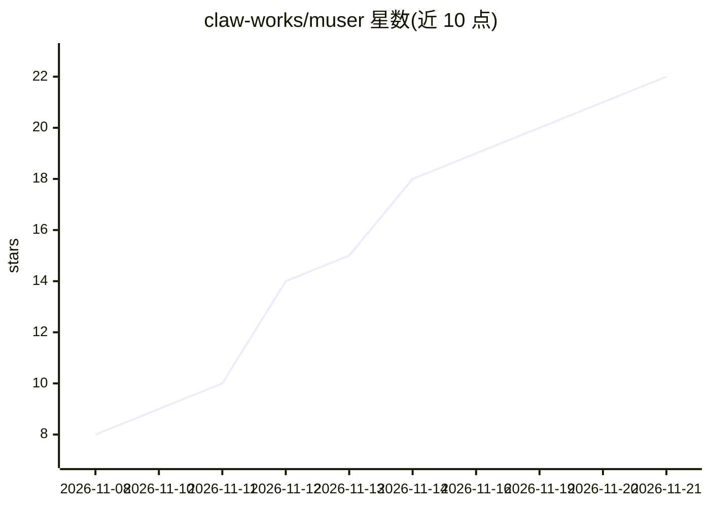

# claw-works/muser

⭐ 22 · Rust · Apache-2.0 · 推送 2026-11-15 · [GitHub](https://github.com/claw-works/muser) · 组织维护 · 中文 README

**面向 AI agent 的无头音乐编曲引擎，用数据而非鼠标编曲**

Rust 编写的确定性音频编曲引擎，音频由 crates.io 依赖 manguebyte 实时合成。供 AI agent（Claude Code、Codex、Cursor 等）通过结构化项目 JSON + CLI + MCP server 三种接口驱动：agent 编辑项目 JSON 表达音乐意图，引擎渲染为音频。提供 100+ 内置乐器、SFZ 采样器、效果链与混音路由、CLAP/VST3/LV2 插件加载、WAV/MIDI/ABC 导出、live 模式实时分段演奏，以及面向 agent 的 audition、mix-report、analyze 等反馈工具。安装为一行脚本下载发布二进制，支持 self-update。

## 筛选速览

| 维度 | 判定 | 备注 |
|---|---|---|
| AI 角色 | `ai-ecosystem` | LLM/agent 周边工具 |
| 许可风险 | `permissive` | Apache-2.0 |
| 部署形态 | `desktop` | 安装包/桌面程序 |
| 模型依赖 | — | README 未给出锁定关系 |
| 硬件要求 | — | 无带数字的原话,不猜 |
| 安装摩擦 | `medium` | 含编译或系统依赖之一 |
| 成熟度 | — | 结构信号不足 |

## 能力要点

- 结构化项目 JSON + CLI + MCP server 双 AI 接口，引擎持有确定性音频输出
- 100+ 内置乐器实时合成、SFZ 采样器与第三方 CLAP/VST3/LV2 插件支持
- 面向 agent 的反馈工具：audition 试参、mix-report 响度报告、analyze 听觉分析
- 导出 WAV/MIDI/ABC/stems，`muser export-daw` 可移交 Live/Cubase/Logic 等 DAW

## 适用场景

- 通过对话让 AI agent 帮我编曲、改混音并渲染成品
- agent 实时分段演奏的 live 即兴演奏会话
- 把 AI 生成的编曲导出为 MIDI/stems 交给 DAW 继续制作

## 场景标签

 · 领域:音乐制作/音频工具

## 证据(README 行号)

> L7: **A headless music-arrangement engine built for AI.**
> L10: **a structured project format + a CLI + an MCP server**: an AI agent expresses musical intent by writing or editing
> L85: - Two AI interfaces: **CLI** (shell calls) and **MCP server** (direct tool calls from the agent)

## 星数曲线

2026-11-08 8 → 2026-11-21 22（+14）

---
*卡片 v1 · prompt 1.4 · 生成 2026-11-18 · 置信度 high · 依据 README sha `bf7c2b1a7b8c` · [字段定义](../../DATASET.md)*
