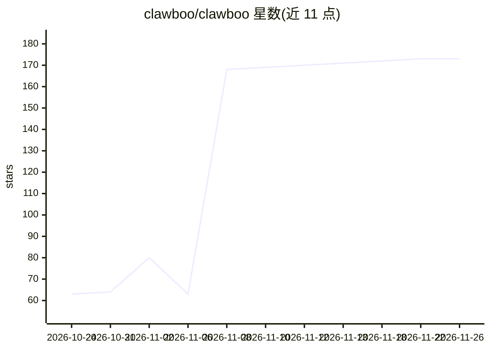

# clawboo/clawboo

⭐ 173 · TypeScript · MIT · 推送 2026-11-24 · [GitHub](https://github.com/clawboo/clawboo) · [官网](https://www.claw.boo) · 组织维护

**自托管的多 AI agent 团队编排工作室：一次提问自动分派协作**

开源、自托管的多 agent 团队运行平台：用户在群聊中提问，领队 agent Boo Zero 将请求拆为看板任务并分派给不同 teammate，每个 teammate 可运行在 Claude Code、Codex、Hermes、OpenClaw 或 Clawboo 内置 agent 之上，过程在看板、群聊与组织图中实时可见。模型通过 API key（Anthropic、OpenAI、OpenRouter 等 11 家）、本地 Ollama 或 ChatGPT 订阅接入；提供共享团队记忆、预算与花费追踪、代码级委托深度限制与风险操作审批。通过 npx 或 npm 全局安装，浏览器内向导完成配置。

## 筛选速览

| 维度 | 判定 | 备注 |
|---|---|---|
| AI 角色 | `ai-ecosystem` | LLM/agent 周边工具 |
| 许可风险 | `permissive` | MIT |
| 部署形态 | `library` | 以包/库形式分发 |
| 模型依赖 | local-ok | 支持本地模型 |
| 硬件要求 | — | 无带数字的原话,不猜 |
| 安装摩擦 | `low` | 无编译、无系统依赖或容器化 |
| 成熟度 | — | 结构信号不足 |

## 能力要点

- Boo Zero 将一次请求拆为看板任务并自动分派给 teammate
- teammate 可运行于 Claude Code、Codex、Hermes、OpenClaw 或内置 agent
- 支持 11 家 API 提供商、本地 Ollama 无 key 使用与 ChatGPT 订阅登录
- 预算告警/硬上限、代码级委托深度与 fan-out 限制、风险工具调用审批

## 适用场景

- 让一支 agent 团队协作完成发布计划、文案与竞品比价
- 自托管搭建混合多运行时（Claude Code/Codex/OpenClaw）的 agent 团队
- 用本地 Ollama 模型在无 API key 下运行 agent 团队
- 给营销、开发或研究小组配备可观测、可审批的 agent 分工看板

## 场景标签

`Agent 框架` `多智能体` · 领域:Agent 开发

## 证据(README 行号)

> L5:  Ask once. Boo Zero, your team lead, splits the work into jobs on one board
> L10:  Your agents use the AI you connect: an API key (Anthropic, OpenAI, OpenRouter or seven more), a free local model t
> L106: - **Routines replace the Scheduler.** Put work on a clock. A team routine posts into the group chat for Boo Zero t

## 星数曲线

2026-10-24 63 → 2026-11-26 173（+110）

---
*卡片 v1 · prompt 1.4 · 生成 2026-11-26 · 置信度 high · 依据 README sha `befd0b0e870c` · [字段定义](../../DATASET.md)*
