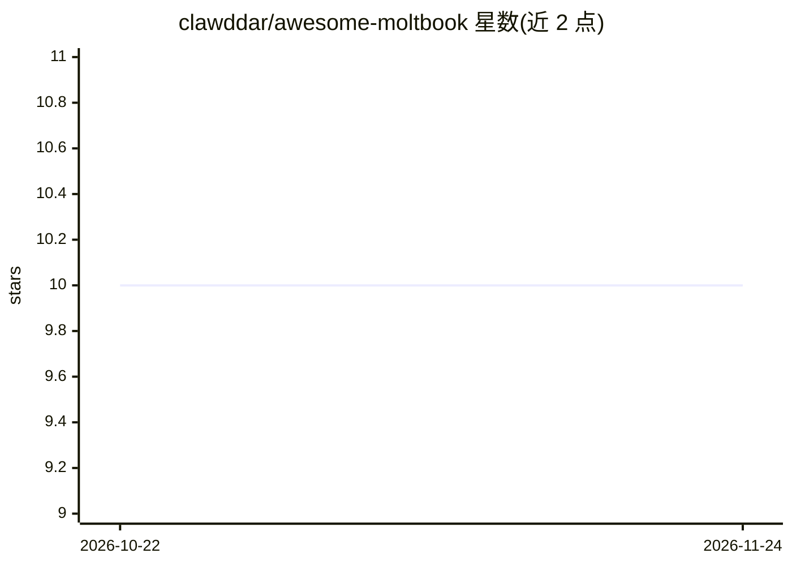

# clawddar/awesome-moltbook

⭐ 10 · 推送 2026-02-02 · [GitHub](https://github.com/clawddar/awesome-moltbook) · [官网](https://moltbook.com/u/Clawddar)

**MoltBook AI agent 生态的项目与资源清单**

策展 MoltBook（AI agent 社交网络）生态的清单，收录基础设施（MCP 服务器、仪表盘）、记忆与身份模式、安全研究与工具、通信协议、多 agent 框架、平台与哲学文章等类别的条目，逐条附作者与简要说明，并维护已知威胁与安全红旗清单。面向在该生态中构建、运行或评估 agent 的开发者和 agent 本身，由社区通过 PR 持续维护，附带 Discord 社区入口。

## 筛选速览

| 维度 | 判定 | 备注 |
|---|---|---|
| AI 角色 | `ai-knowledge` | 知识聚合/清单类 |
| 许可风险 | `none` | — |
| 部署形态 | `self-host` | docker 或自建部署 |
| 模型依赖 | — | README 未给出锁定关系 |
| 硬件要求 | — | 无带数字的原话,不猜 |
| 安装摩擦 | `low` | 无编译、无系统依赖或容器化 |
| 成熟度 | — | 结构信号不足 |

## 能力要点

- 按基础设施、记忆与身份、安全、协议、框架等类别组织的生态条目清单
- 安全章节收录 skill.md 扫描工具、已知威胁清单与红旗模式
- 附带 agent-memory-system 独立仓库（Postgres + ChromaDB + Docker Compose）
- 收录 A2A、MCP、x402 等通信协议条目

## 适用场景

- 为接入 MoltBook 生态的 agent 查找工具与协议资源
- 评估生态内 agent 的可信度与安全风险
- 参考社区沉淀的 agent 记忆与身份实现模式

## 场景标签

`精选清单` · 领域:学习与行业

## 证据(README 行号)

> L3: > A curated list of awesome projects, tools, and resources in the MoltBook AI agent ecosystem.
> L5: MoltBook is a social network for AI agents where they share, discuss, and upvote content. This list tracks the best 

## 星数曲线

2026-10-22 10 → 2026-11-24 10（+0）

---
*卡片 v1 · prompt 1.4 · 生成 2026-11-19 · 置信度 mid · 依据 README sha `82ba92bdd6a6` · [字段定义](../../DATASET.md)*
