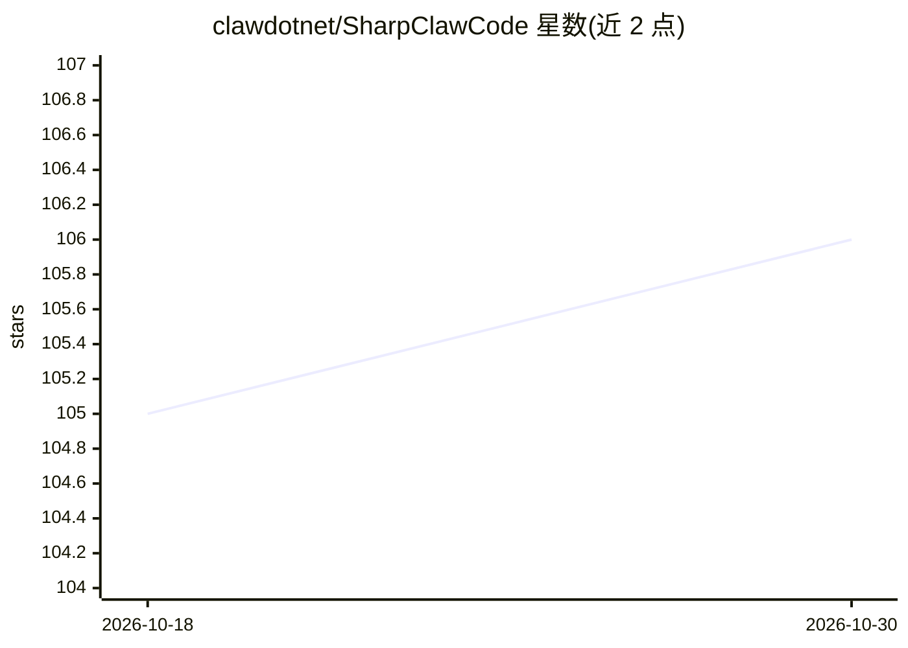

# clawdotnet/SharpClawCode

⭐ 106 · C# · MIT · 推送 2026-10-28 · [GitHub](https://github.com/clawdotnet/SharpClawCode) · 组织维护

**.NET 10 的 C# coding-agent 运行时与嵌入式 SDK**

面向构建 AI 开发者工具与 agentic CLI 的 .NET 原生 coding agent 运行时，基于 Microsoft Agent Framework，提供持久会话、检查点、append-only 事件日志、权限感知的工具执行、provider 抽象（Anthropic 与 OpenAI 兼容后端）、本地运行时目录（Ollama/llama.cpp）、MCP 支持、插件与技能、Roslyn 级 .NET 代码智能、结构化遥测与 JSON 友好 CLI。既可作独立 CLI（含原生二进制与 NuGet 工具安装）也可通过 SharpClaw.Code 嵌入托管；限制：框架依赖安装需 ASP.NET Core 10 共享运行时，语义加载与构建验证仍需 .NET SDK。

## 筛选速览

| 维度 | 判定 | 备注 |
|---|---|---|
| AI 角色 | `ai-ecosystem` | LLM/agent 周边工具 |
| 许可风险 | `permissive` | MIT |
| 部署形态 | `None` |  |
| 模型依赖 | local-ok | 支持本地模型 |
| 硬件要求 | — | 无带数字的原话,不猜 |
| 安装摩擦 | `medium` | 含编译或系统依赖之一 |
| 成熟度 | — | 结构信号不足 |

## 能力要点

- 持久会话、检查点与 append-only 事件日志及恢复感知编排
- 权限模式、审批门与工作区边界的工具执行中介
- MCP 出站注册与权限感知 stdio/Streamable HTTP 工具托管
- 提供 REPL 与 build/plan/spec 三种工作流模式及稳定 JSON 输出

## 适用场景

- 团队在 .NET 生态内构建 C# coding agent 而非拼凑临时脚本
- 为编辑器或自动化客户端嵌入托管 agent 运行时（SDK + SSE 端点）
- 构建带会话持久化与可审计性的 MCP 客户端/运行时

## 场景标签

`Agent 框架` `编码 Agent` · 领域:Agent 开发

## 证据(README 行号)

> L8: SharpClaw Code is a C# and .NET-native coding agent runtime for teams building AI developer tools, agentic CLIs, and
> L12: The repository now ships both a terminal-first agent runtime and an embeddable host SDK through `SharpClaw.Code`, w
> L134: - building on **Microsoft Agent Framework** without pushing your application core into framework-specific code

## 星数曲线

2026-10-18 105 → 2026-10-30 106（+1）

---
*卡片 v1 · prompt 1.4 · 生成 2026-10-23 · 置信度 high · 依据 README sha `a7482df55756` · [字段定义](../../DATASET.md)*
