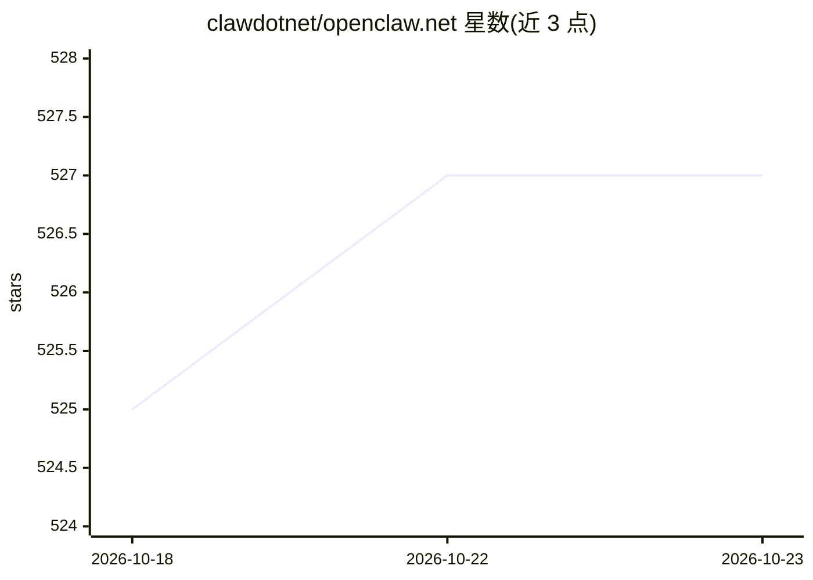

# clawdotnet/openclaw.net

⭐ 527 · C# · MIT · 推送 2026-10-21 · [GitHub](https://github.com/clawdotnet/openclaw.net) · [官网](https://www.agentqi.dev) · 组织维护 · 中文 README

**.NET 自托管 AI agent 运行时，带桌面伴侣应用**

自托管的 AI agent 运行时与网关，用 .NET 实现并兼容 NativeAOT，灵感来自 OpenClaw 但独立实现。提供流式对话、工具执行、会话、记忆、80+ 工具面、Telegram/WhatsApp/Teams 等渠道适配、OpenAI 兼容端点、MCP 与 WebSocket 接口；模型支持 OpenAI、Claude、Gemini、Azure OpenAI、DeepSeek、Ollama 及可选嵌入式本地推理。AgentQi Companion 是配套的 Avalonia 桌面应用，提供三平台打包下载（当前未签名）；也可用 .NET 10 SDK 从源码运行。网关默认绑定回环地址，公开暴露前有安全限制。

## 筛选速览

| 维度 | 判定 | 备注 |
|---|---|---|
| AI 角色 | `ai-ecosystem` | LLM/agent 周边工具 |
| 许可风险 | `permissive` | MIT |
| 部署形态 | `None` |  |
| 模型依赖 | local-ok | 支持本地模型 |
| 硬件要求 | — | 无带数字的原话,不猜 |
| 安装摩擦 | `medium` | 含编译或系统依赖之一 |
| 成熟度 | — | 结构信号不足 |

## 能力要点

- agent 运行时：流式、工具执行、取消/重试、会话、记忆、token 用量上报
- 多接口：桌面伴侣、浏览器 chat/admin、CLI、OpenAI 兼容 API、MCP、WebSocket
- 多模型接入：OpenAI/Claude/Gemini/Azure/DeepSeek/Ollama 及 OpenAI 兼容提供方
- MetaSkills 可审计 DAG 工作流与 Fractal Memory 项目记忆（写入需 opt-in）

## 适用场景

- 本地或团队自托管运行 AI 助手与网关
- 通过桌面、浏览器、消息渠道或 API 使用同一 agent
- 用 .NET 扩展运行时并以 NativeAOT 部署核心路径

## 场景标签

`Agent 框架` `模型网关` `AI 助手` · 领域:Agent 开发

## 证据(README 行号)

> L5: **A self-hosted AI agent runtime for .NET, with a desktop companion for everyday use.**
> L14: Run an assistant locally or host a gateway for your team. Connect a hosted or local model, give it tools and memory
> L116: |Interfaces|AgentQi Companion, browser chat and admin UI, CLI, terminal UI, OpenAI-compatible HTTP endpoints, MCP,
> L117: |Models|OpenAI, Claude, Gemini, Azure OpenAI, DeepSeek, Ollama, and OpenAI-compatible providers; named profiles an

## 星数曲线

2026-10-18 525 → 2026-10-23 527（+2）

---
*卡片 v1 · prompt 1.4 · 生成 2026-10-21 · 置信度 high · 依据 README sha `a61da63e41be` · [字段定义](../../DATASET.md)*
