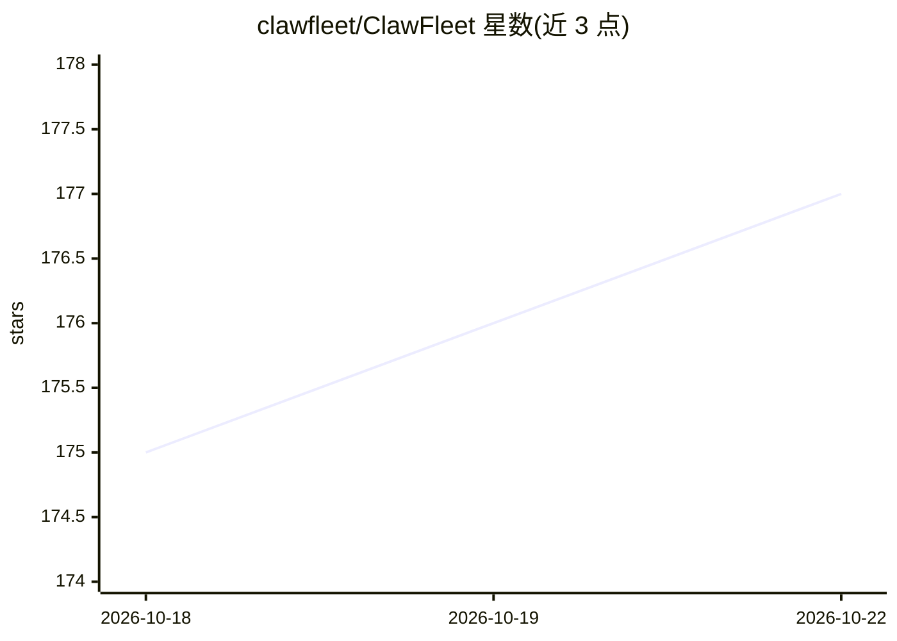

# clawfleet/ClawFleet

⭐ 177 · Go · MIT · 推送 2026-04-27 · [GitHub](https://github.com/clawfleet/ClawFleet) · [官网](https://clawfleet.io) · 组织维护 · 中文 README

**本机 Docker 容器中编排 OpenClaw/Hermes 多 AI agent 的机群管理器**

在 macOS/Linux 单机上以 Docker 容器隔离方式运行 OpenClaw 与 Hermes 两类 agent 运行时，并通过浏览器 Dashboard 统一管理：注册 LLM API 密钥（OpenAI/Anthropic/Google/DeepSeek/ChatGPT 订阅）、可复用人设（Character）、消息渠道（Discord/Telegram/Slack 等）、技能与 Soul 快照克隆；提供 CLI 与 noVNC 浏览器桌面查看 agent 图形界面。限制：角色、技能、Soul 归档目前为 OpenClaw 专属，Hermes 的 Dashboard 覆盖为容器生命周期与配置，noVNC 暂仅 OpenClaw 镜像。面向想在自有硬件部署多 agent、接入自有订阅的开发者。

## 筛选速览

| 维度 | 判定 | 备注 |
|---|---|---|
| AI 角色 | `ai-ecosystem` | LLM/agent 周边工具 |
| 许可风险 | `permissive` | MIT |
| 部署形态 | `self-host` | docker 或自建部署 |
| 模型依赖 | locked-api |  |
| 硬件要求 | — | 无带数字的原话,不猜 |
| 安装摩擦 | `low` | 无编译、无系统依赖或容器化 |
| 成熟度 | `idea` | |

## 能力要点

- 每个 agent 独立 Docker 容器隔离运行（文件系统与网络隔离）
- 统一 Dashboard 管理 Models/Characters/Channels 共享资产池
- Soul Archive：快照人设+记忆+配置并克隆到新实例
- 52 内置 + 13,000+ ClawHub 社区技能（OpenClaw）

## 适用场景

- 在一台机器上同时运行多个不同人设的 AI agent 并接入 Discord 等渠道协作
- 用现有 ChatGPT 订阅驱动本地 agent，避免云服务开销
- 保存表现出色的 agent 配置并快速复制扩充团队

## 场景标签

 · 领域:AI agent 基础设施/自动化

## 证据(README 行号)

> L12: > Run a fleet of AI agents on your laptop in 5 minutes — OpenClaw and Hermes in isolated containers, managed from o
> L35: - **Two runtimes, one Dashboard** — OpenClaw and Hermes, both first-class (more ↓)
> L134: ClawFleet manages all agent runtimes as first-class citizens in one unified Dashboard — with shared asset pool (Mo

## 星数曲线

2026-10-18 175 → 2026-10-22 177（+2）

---
*卡片 v1 · prompt 1.4 · 生成 2026-10-22 · 置信度 mid · 依据 README sha `fb6f7710a0a6` · [字段定义](../../DATASET.md)*
