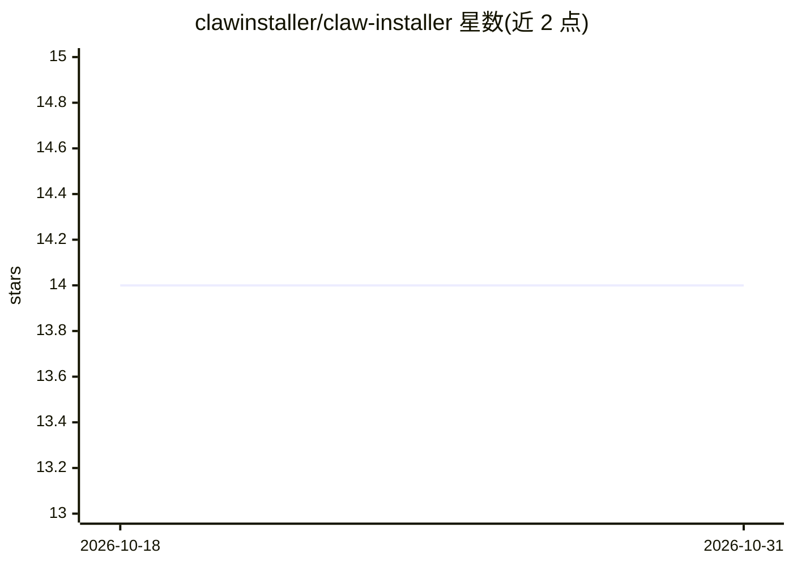

# clawinstaller/claw-installer

⭐ 14 · Swift · MIT · 推送 2026-03-06 · [GitHub](https://github.com/clawinstaller/claw-installer) · [官网](https://clawinstaller.github.io/website/) · 个人维护 · 中文 README

**macOS 圖形化安裝精靈：3 分鐘完成 OpenClaw 設定**

以 Swift 6.0 / SwiftUI 開發的原生 macOS GUI 安裝精靈，用於自動化 OpenClaw 的安裝流程：環境檢查（Node.js >=22、套件管理器、CPU 架構、磁碟空間）、一鍵安裝（npm/pnpm/bun）、LLM 設定（Anthropic OAuth/API key、Google Gemini、Ollama）、頻道設定（Telegram/Discord/WhatsApp）與技能安裝。提供錯誤自動診斷修復（如 Homebrew 裝 Node.js、Xcode CLI Tools 安裝、切換 registry 鏡像）。健康監視器與 AI 助手排疑為規劃中功能。需 macOS 14+，可從 Releases 下載 .dmg 或以 swift build 從原始碼建置。

## 筛选速览

| 维度 | 判定 | 备注 |
|---|---|---|
| AI 角色 | `ai-ecosystem` | LLM/agent 周边工具 |
| 许可风险 | `permissive` | MIT |
| 部署形态 | `desktop` | 安装包/桌面程序 |
| 模型依赖 | — | README 未给出锁定关系 |
| 硬件要求 | — | 无带数字的原话,不猜 |
| 安装摩擦 | `low` | 无编译、无系统依赖或容器化 |
| 成熟度 | — | 结构信号不足 |

## 能力要点

- 環境檢查與一鍵修復（Node.js、原生依賴、PATH 偵測）
- 支援 npm/pnpm/bun 即時終端輸出安裝
- LLM 設定支援 Anthropic（OAuth + API key）、Google Gemini、Ollama，可偵測既有配置
- Telegram/Discord/WhatsApp 頻道逐步設定與 token 驗證

## 适用场景

- 在 macOS 上圖形化完成 OpenClaw 的安裝與 LLM/頻道設定
- 安裝失敗時獲得自動診斷與一鍵修復
- 選取並一鍵安裝 OpenClaw 技能

## 场景标签

 · 领域:開發者工具/AI agent 安裝配置

## 证据(README 行号)

> L3:  Install OpenClaw in 3 minutes instead of 30.
> L55: |**LLM Setup**|Done|Anthropic (OAuth + API key), Google Gemini, Ollama. Detects existing config.|

## 星数曲线

2026-10-18 14 → 2026-10-31 14（+0）

---
*卡片 v1 · prompt 1.4 · 生成 2026-10-31 · 置信度 high · 依据 README sha `6e26e2ee284e` · [字段定义](../../DATASET.md)*
