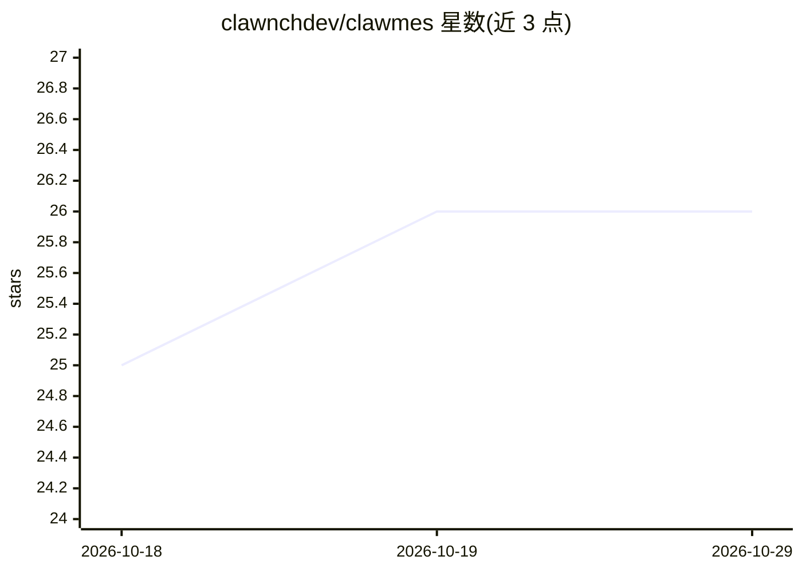

# clawnchdev/clawmes

⭐ 26 · Python · MIT · 推送 2026-09-17 · [GitHub](https://github.com/clawnchdev/clawmes) · [官网](https://github.com/clawnchdev/clawmes) · 组织维护

**Hermes Agent 的加密货币插件：钱包、DEX 交易、借贷质押与链上自动化**

面向 Hermes Agent 的 Python 插件，为聊天式 agent 提供加密货币操作能力：52 个工具、97+ 命令、29 个服务、11 个钩子，覆盖 WalletConnect/本地密钥/托管三种钱包模式、0x 聚合交易、Aave 借贷、Lido 质押、跨链桥、Snapshot 治理投票、自然语言多步自动化计划（时间/价格/链上触发、DCA 循环）及 EIP-7710/7715 链上权限委托。可通过 Telegram、Discord、Slack、Signal 等 7 个渠道使用。README 声明处于 pre-alpha，未经主网验证与第三方安全审计，建议仅用测试网小额资金。

## 筛选速览

| 维度 | 判定 | 备注 |
|---|---|---|
| AI 角色 | `ai-ecosystem` | LLM/agent 周边工具 |
| 许可风险 | `permissive` | MIT |
| 部署形态 | `library` | 以包/库形式分发 |
| 模型依赖 | — | README 未给出锁定关系 |
| 硬件要求 | — | 无带数字的原话,不猜 |
| 安装摩擦 | `low` | 无编译、无系统依赖或容器化 |
| 成熟度 | `idea` | |

## 能力要点

- 三种钱包模式：WalletConnect 手机审批 / 本地 BIP-39 加密密钥 / Bankr 托管
- EIP-7710/7715 链上委托：将支出策略编译为带链上 caveat 的委托，agent 无法越过限额
- 自然语言多步计划：时间/价格/链上触发、条件分支与 DCA 循环，计划持久化并跨重启
- 7 个聊天渠道（Telegram/Discord/Slack/Signal/WhatsApp/iMessage/LINE）工具行为一致
- 支持 Ethereum、Base、Arbitrum、Optimism、Polygon、Linea 及测试网

## 适用场景

- 通过聊天 agent 完成 DEX 交易、借贷与质押操作
- 设置限额与链上委托，让 agent 在受控额度内自主执行交易
- 用自然语言创建 DCA、价格触发等自动化计划
- 跨 Telegram/Discord 等渠道管理加密钱包与治理投票

## 场景标签

`Agent 框架` · 领域:Agent 开发

## 证据(README 行号)

> L13: Clawmes is a Hermes Agent plugin. Wallets, DEX trading, lending and staking, governance, on-chain automation. Pytho
> L15: 52 tools. 97 commands. 29 services. 11 hooks. Runs on Telegram, Discord, Slack, Signal, WhatsApp, iMessage, and LIN

## 星数曲线

2026-10-18 25 → 2026-10-29 26（+1）

---
*卡片 v1 · prompt 1.4 · 生成 2026-10-26 · 置信度 high · 依据 README sha `8d4e5ec788c9` · [字段定义](../../DATASET.md)*
