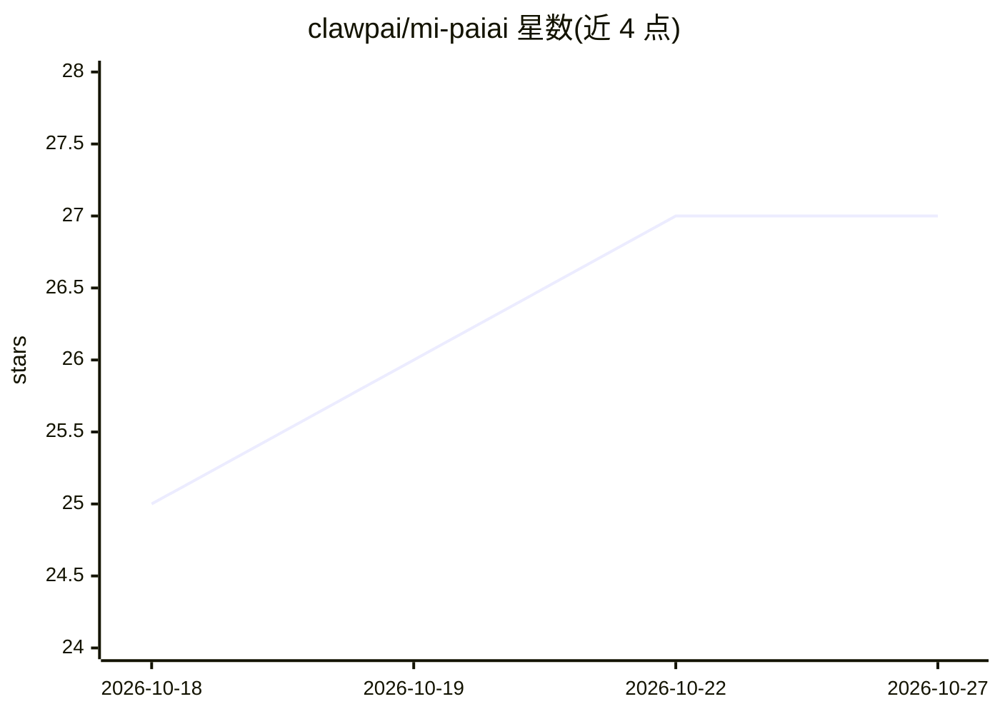

# clawpai/mi-paiai

⭐ 27 · TypeScript · MIT · 推送 2026-09-17 · [GitHub](https://github.com/clawpai/mi-paiai) · 个人维护 · 中文 README

**把小爱音箱接入任意 OpenAI 兼容大模型的自托管网关**

独立维护的社区项目（衍自 migpt-ultimate / migpt-next），通过小米账号接入小爱音箱，把对话请求转发给任意 OpenAI 兼容接口或厂商预设（OpenAI、DeepSeek、Ollama 等）。每台音箱运行于独立子进程与工作目录，令牌缓存与对话上下文隔离。提供网页控制台管理音箱、API Key 与模型目录，支持语音切换模型与思考等级，配置保存后热重载。以多架构 Docker 镜像（amd64/arm64/armv7）分发，面向 NAS 自部署，含登录保护、CSRF 阻断、非 root 只读容器等安全措施。非官方项目，小米接口变更可能导致功能失效。

## 筛选速览

| 维度 | 判定 | 备注 |
|---|---|---|
| AI 角色 | `ai-ecosystem` | LLM/agent 周边工具 |
| 许可风险 | `permissive` | MIT |
| 部署形态 | `self-host` | docker 或自建部署 |
| 模型依赖 | local-ok | 支持本地模型 |
| 硬件要求 | — | 无带数字的原话,不猜 |
| 安装摩擦 | `low` | 无编译、无系统依赖或容器化 |
| 成熟度 | — | 结构信号不足 |

## 能力要点

- 每台音箱独立子进程隔离，多账号多设备互不串线
- 网页控制台管理配置，保存即热重载，无需重启容器
- 内置 30+ AI 厂商预设并支持任意 OpenAI 兼容接口，语音切换模型
- 多架构镜像与安全加固（密钥脱敏、非 root、丢弃全部 capabilities）

## 适用场景

- 让家里的小爱音箱用自选大模型回答问题
- 多台音箱分别绑定不同小米账号与模型部署在一台 NAS 上
- 通过语音指令随时切换模型和思考等级

## 场景标签

`模型网关` `语音 Agent` · 领域:Agent 开发

## 证据(README 行号)

> L20: - **丰富的 AI 厂商预设**：OpenAI、DeepSeek、Gemini、Grok、GLM、通义千问、New API、OpenCode、OpenRouter、Ollama 等；同时支持任意 OpenAI 兼容接口。
> L105: |聚合 / 中转|Sub2API、New API、One API、OpenCode、OpenRouter、AiHubMix|
> L106: |国际主流|OpenAI、Anthropic、Gemini、Grok、Mistral、Groq、Perplexity、Cohere、Together、NVIDIA NIM|
> L107: |国内主流|DeepSeek、GLM、通义千问、Kimi、MiniMax、豆包、腾讯混元、硅基流动、魔搭|
> L108: |本地 / 自建|Ollama、LM Studio、vLLM、SGLang、Azure OpenAI|

## 星数曲线

2026-10-18 25 → 2026-10-27 27（+2）

---
*卡片 v1 · prompt 1.4 · 生成 2026-10-26 · 置信度 mid · 依据 README sha `02be45c8afef` · [字段定义](../../DATASET.md)*
