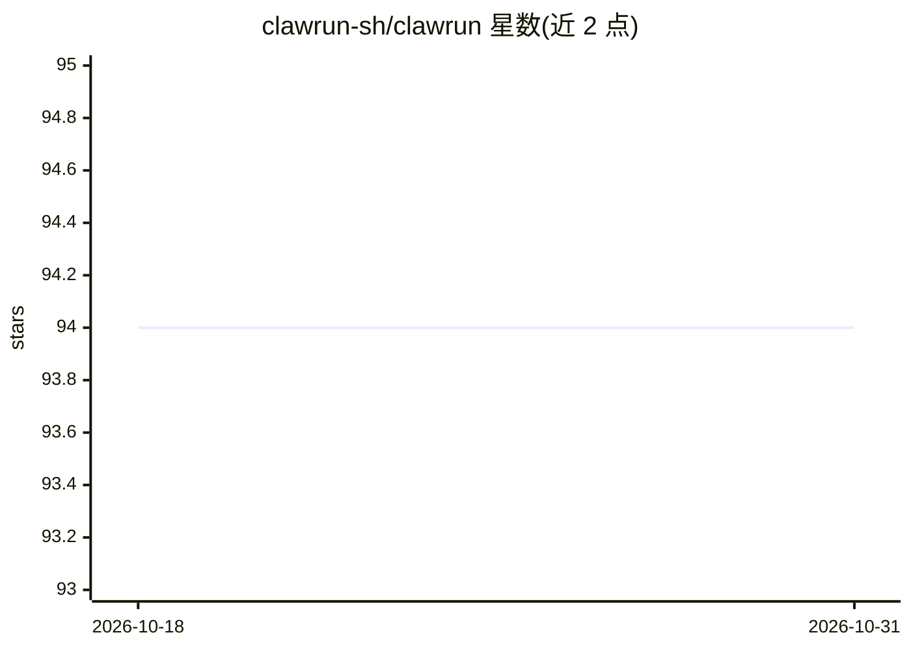

# clawrun-sh/clawrun

⭐ 94 · TypeScript · Apache-2.0 · 推送 2026-06-12 · [GitHub](https://github.com/clawrun-sh/clawrun) · [官网](https://clawrun.sh) · 组织维护

**开源 AI agent 的托管与生命周期管理层**

ClawRun 是面向开源 AI agent 的托管与生命周期层：将 agent 部署到安全沙箱（当前支持 Vercel Sandbox，更多 provider 在计划中），并管理启动、心跳保活、快照/恢复与消息唤醒等完整生命周期。支持单命令部署，可接入 Telegram、Discord、Slack、WhatsApp 等消息通道，提供 Web 仪表盘与 CLI 进行实时聊天和管理，含成本追踪与预算限制，agent、provider、通道均为可插拔架构。通过 npx 安装使用，Apache-2.0 许可。

## 筛选速览

| 维度 | 判定 | 备注 |
|---|---|---|
| AI 角色 | `ai-ecosystem` | LLM/agent 周边工具 |
| 许可风险 | `permissive` | Apache-2.0 |
| 部署形态 | `library` | 以包/库形式分发 |
| 模型依赖 | — | README 未给出锁定关系 |
| 硬件要求 | — | 无带数字的原话,不猜 |
| 安装摩擦 | `low` | 无编译、无系统依赖或容器化 |
| 成熟度 | — | 结构信号不足 |

## 能力要点

- 单命令部署 agent 到安全沙箱（Vercel Sandbox）
- 沙箱空闲休眠、消息唤醒、快照/恢复等生命周期管理
- 接入 Telegram/Discord/Slack/WhatsApp 等消息通道
- 成本追踪与预算限制，Web 仪表盘与 CLI 管理

## 适用场景

- 把开源 AI agent 一条命令部署到沙箱运行
- 通过 Telegram/Discord 等聊天工具与自己的 agent 对话
- 对多通道 agent 统一做成本追踪和预算控制

## 场景标签

`Agent 框架` · 领域:Agent 开发

## 证据(README 行号)

> L25: ClawRun is a hosting and lifecycle layer for open-source AI agents. It deploys agents into secure sandboxes (Vercel
> L31: - 🚀 Deploy any supported AI agent with a single command

## 星数曲线

2026-10-18 94 → 2026-10-31 94（+0）

---
*卡片 v1 · prompt 1.4 · 生成 2026-10-23 · 置信度 high · 依据 README sha `99317fa2f9d5` · [字段定义](../../DATASET.md)*
