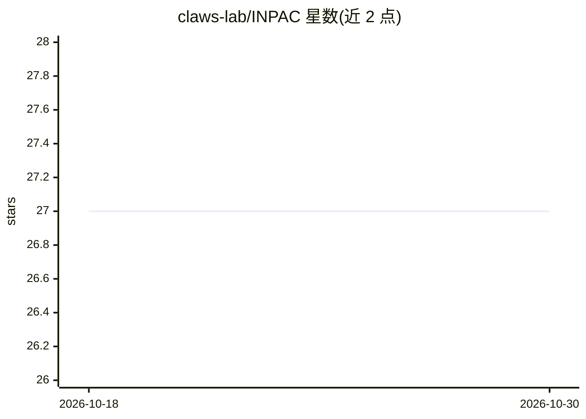

# claws-lab/INPAC

⭐ 27 · Python · BSD-3-Clause · 推送 2025-11-11 · [GitHub](https://github.com/claws-lab/INPAC) · 组织维护

**预测内容跨在线社区传播路径的动态图神经网络框架**

KDD 2023 论文的代码与数据：针对社区级信息路径预测任务（CLIPP），基于 2018-2022 年 Reddit 分享 YouTube 视频的大规模多模态数据集构建社区影响图（CIG），提出动态图框架 INPAC 捕捉视频跨社区传播的时变性与多模态特征。提供 HuggingFace 数据集加载、conda 依赖安装与 main.py 训练/评估入口，支持 warm-start 与 cold-start 场景实验。面向科研复现人员，推荐使用 PyCharm 运行。

## 筛选速览

| 维度 | 判定 | 备注 |
|---|---|---|
| AI 角色 | `ai-native` | 本体是模型或模型工具 |
| 许可风险 | `permissive` | BSD-3-Clause |
| 部署形态 | `library` | 以包/库形式分发 |
| 模型依赖 | — | README 未给出锁定关系 |
| 硬件要求 | — | 无带数字的原话,不猜 |
| 安装摩擦 | `medium` | 含编译或系统依赖之一 |
| 成熟度 | — | 结构信号不足 |

## 能力要点

- 动态图框架融合社区影响图（CIG）建模传播路径
- 覆盖 60 个月 Reddit-YouTube 跨社区分享数据集（HuggingFace 提供）
- 支持 warm-start 与 cold-start 两种实验场景
- 论文在 KDD 2023 发表并附引用信息

## 适用场景

- 复现 KDD 2023 论文的 CLIPP 实验结果
- 研究内容在在线社区间的传播轨迹预测
- 利用提供的 Reddit/YouTube 数据集做时序图研究

## 场景标签

`科研工具` · 领域:学习与行业

## 证据(README 行号)

> L3: This repository contains the code and data for the KDD 2023 paper Predicting Information Pathways Across Online Comm
> L18: The problem of community-level information pathway prediction (CLIPP) aims at predicting the transmission trajector

## 星数曲线

2026-10-18 27 → 2026-10-30 27（+0）

---
*卡片 v1 · prompt 1.4 · 生成 2026-10-26 · 置信度 mid · 依据 README sha `cc27a0845e7d` · [字段定义](../../DATASET.md)*
