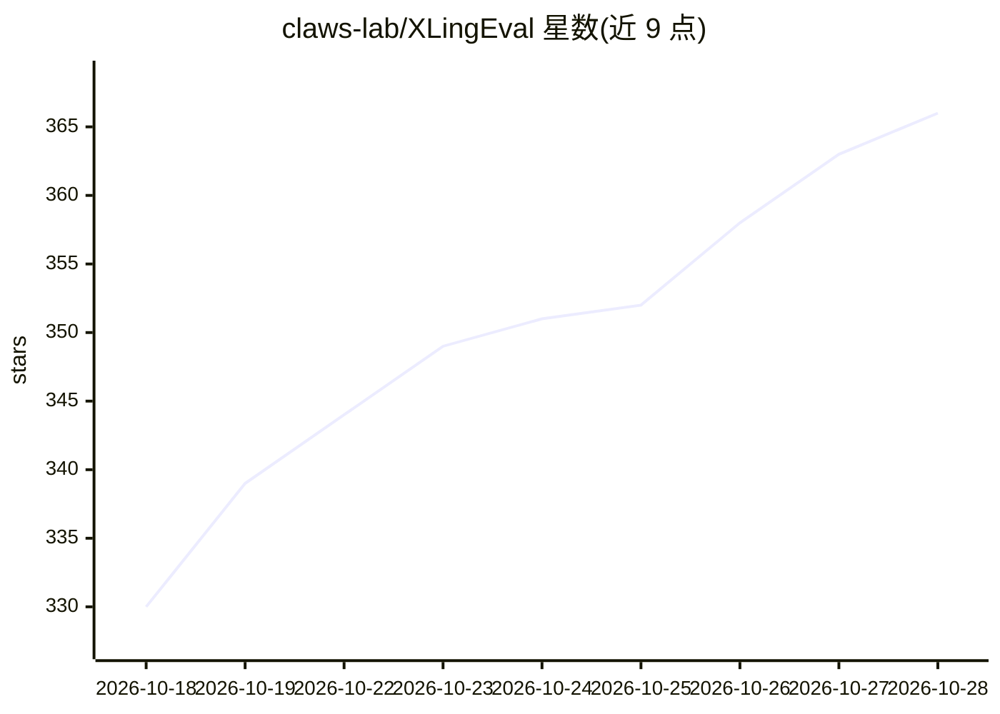

# claws-lab/XLingEval

⭐ 372 · Python · Apache-2.0 · 推送 2026-05-14 · [GitHub](https://github.com/claws-lab/XLingEval) · [官网](https://claws-lab.github.io/XLingEval/) · 组织维护

**医疗问答 LLM 跨语言评测框架与基准数据集（论文代码）**

Web Conference 2024 论文 "Better to Ask in English" 的代码与资源库：提供 XLingEval 三轴评测框架（正确性、一致性、可验证性），结合算法指标（LLM-judge、BERTScore/SBERT、LDA/HDP、Macro-F1 等）与医学标注者人工评估；附 XLingHealth 基准（HealthQA/LiveQA/MedicationQA 的英西中印四语版本），并发布于 Hugging Face。评测对象覆盖 GPT-3.5/4（OpenAI API）与开源 MedAlpaca 系列。以 conda 环境加 pip 依赖的 Python 脚本形式运行，Apache 2.0 许可。

## 筛选速览

| 维度 | 判定 | 备注 |
|---|---|---|
| AI 角色 | `ai-ecosystem` | LLM/agent 周边工具 |
| 许可风险 | `permissive` | Apache-2.0 |
| 部署形态 | `library` | 以包/库形式分发 |
| 模型依赖 | — | README 未给出锁定关系 |
| 硬件要求 | — | 无带数字的原话,不猜 |
| 安装摩擦 | `low` | 无编译、无系统依赖或容器化 |
| 成熟度 | — | 结构信号不足 |

## 能力要点

- 正确性/一致性/可验证性三轴评测管线，含 LLM-judge 与人工评估
- XLingHealth 数据集：3 个专家标注医疗问答集 × 4 种语言
- 覆盖 GPT-3.5、GPT-4 与 MedAlpaca（7B/13B/30B）
- 结果输出至 outputs/ 目录，含统计检验与可视化模块

## 适用场景

- 复现论文中的跨语言医疗问答 LLM 评测实验
- 对自研医疗对话模型做多语言正确性/一致性/可验证性检验
- 引用四语医疗问答基准数据做下游研究

## 场景标签

`模型评测` · 领域:评测与运维

## 证据(README 行号)

> L23: Large language models (LLMs) are transforming the ways the general public accesses and consumes information. Their 
> L29: - ⚖️ **Three-axis evaluation framework** — XLingEval unifies **correctness**, **consistency**, and **verifiability*
> L40: |✅ **Correctness**|Whether the LLM's answer matches expert ground-truth|LLM-judge comparative analysis (CoT prompti

## 星数曲线

2026-10-18 330 → 2026-10-28 366（+36）

---
*卡片 v1 · prompt 1.4 · 生成 2026-10-21 · 置信度 high · 依据 README sha `a3a04276b1d7` · [字段定义](../../DATASET.md)*
