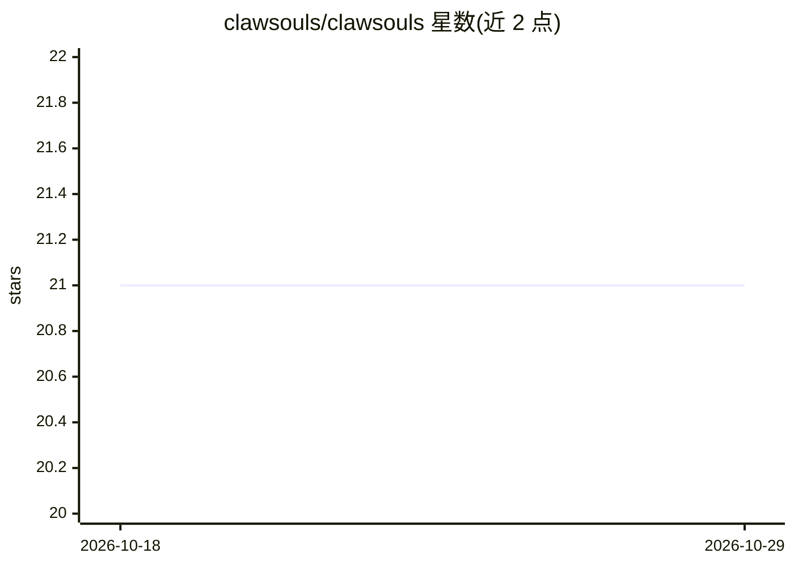

# clawsouls/clawsouls

⭐ 21 · Apache-2.0 · 推送 2026-09-02 · [GitHub](https://github.com/clawsouls/clawsouls) · 组织维护

**AI agent 人格（soul）分享平台：80+ 人格一键安装**

开放规范 SOUL.md 格式的 AI agent 人格分享平台，收录 79+ 精选 soul（纯 markdown 文件，无代码、无 API key）。提供 npx CLI 一键安装 soul 到 agent 工作区，自动检测 OpenClaw/ZeroClaw/Clawdbot 等平台，也可通过 --use 直接注入 Claude Code、Cursor、Cline、Windsurf 等编码 agent 的规则文件；AGENTS.md 类文件以标记合并方式保留原内容。支持 init 脚手架创建并发布自定义 soul，规范 v0.5 含面向具身 agent 的 physical 环境字段。

## 筛选速览

| 维度 | 判定 | 备注 |
|---|---|---|
| AI 角色 | `ai-ecosystem` | LLM/agent 周边工具 |
| 许可风险 | `permissive` | Apache-2.0 |
| 部署形态 | `library` | 以包/库形式分发 |
| 模型依赖 | — | README 未给出锁定关系 |
| 硬件要求 | — | 无带数字的原话,不猜 |
| 安装摩擦 | `low` | 无编译、无系统依赖或容器化 |
| 成熟度 | — | 结构信号不足 |

## 能力要点

- SOUL.md 开放规范，纯 markdown 人格文件，LLM 无关、平台可移植
- npx 一条命令安装 soul，自动检测 agent 平台工作区
- 支持注入 Claude Code / Cursor / Cline / Windsurf / Codex 等 7 类编码 agent 框架
- AGENTS.md 合并时以 clawsouls 标记保留用户原文件

## 适用场景

- 给我的编码 agent 换一个一致的人格和行为风格
- 浏览并试用社区精选的 agent 人格
- 用脚手架创建并发布自己的 soul

## 场景标签

`提示工程` `精选清单` · 领域:Agent 开发

## 证据(README 行号)

> L9: ClawSouls is an open-spec platform for shareable AI agent personas. 80+ curated souls. One command to install. Built
> L35: Or install a soul straight into your coding agent with `--use`:
> L64: No code. No API keys. No vendor lock-in. Just text files that any AI can read.

## 星数曲线

2026-10-18 21 → 2026-10-29 21（+0）

---
*卡片 v1 · prompt 1.4 · 生成 2026-10-28 · 置信度 high · 依据 README sha `257620bac322` · [字段定义](../../DATASET.md)*
