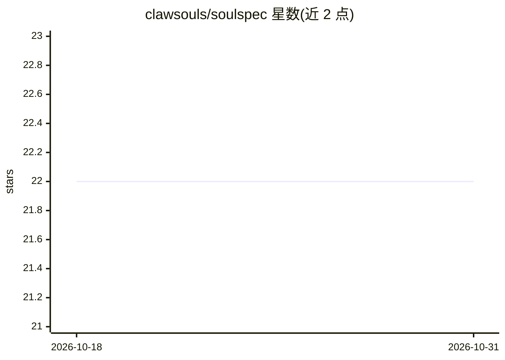

# clawsouls/soulspec

⭐ 22 · TypeScript · Apache-2.0 · 推送 2026-09-02 · [GitHub](https://github.com/clawsouls/soulspec) · [官网](https://soulspec.org) · 组织维护

**AI agent 人格的开放标准：SOUL.md 单文件持久身份**

定义 AI agent 人格的开放规范：以 soul.json 与 SOUL.md 为核心（IDENTITY/AGENTS/USER 等文件可选），通过 npx clawsouls CLI 创建、安装、发布 soul，框架在每次会话加载文件使身份跨会话、跨模型保留。提供 SoulScan 53 项自动化安全校验、80+ 社区人格市场、MCP Server、VS Code 扩展等生态工具；兼容 OpenClaw/Claude Code/Cursor/Windsurf/ChatGPT 等。规范当前版本 v0.5，代码 Apache 2.0、文档 CC-BY-4.0。

## 筛选速览

| 维度 | 判定 | 备注 |
|---|---|---|
| AI 角色 | `ai-ecosystem` | LLM/agent 周边工具 |
| 许可风险 | `permissive` | Apache-2.0 |
| 部署形态 | `library` | 以包/库形式分发 |
| 模型依赖 | — | README 未给出锁定关系 |
| 硬件要求 | — | 无带数字的原话,不猜 |
| 安装摩擦 | `low` | 无编译、无系统依赖或容器化 |
| 成熟度 | — | 结构信号不足 |

## 能力要点

- SOUL.md 单文件人格规范，框架每次会话加载以持久化身份
- SoulScan 53 项自动化安全检查（身份矛盾/越权/劫持漏洞等）
- npx clawsouls CLI 支持 init/install/publish/soulscan/browse
- 80+ 社区人格市场与 MCP Server、VS Code 扩展生态

## 适用场景

- 让我的 AI agent 在多次会话和更换模型后保持同一人格
- 为不同 AI 工具（Claude Code/Cursor 等）复用同一份人格定义
- 部署前用 SoulScan 校验人格文件的安全性

## 场景标签

`Agent 记忆` · 领域:Agent 开发

## 证据(README 行号)

> L19: **Soul Spec fixes that.** Drop a `SOUL.md` file into any agent. It persists across sessions, survives model swaps, 
> L67: Your agent's personality is defined in `SOUL.md` — not a system prompt that decays, but a structured file that the 

## 星数曲线

2026-10-18 22 → 2026-10-31 22（+0）

---
*卡片 v1 · prompt 1.4 · 生成 2026-10-27 · 置信度 high · 依据 README sha `3ad3d72e5699` · [字段定义](../../DATASET.md)*
