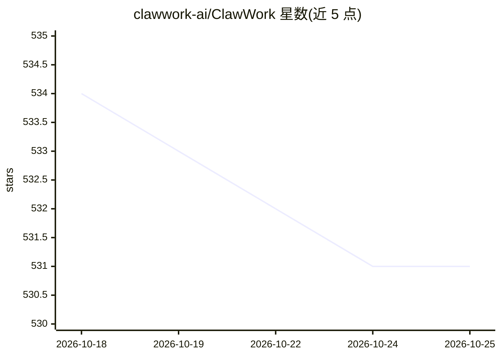

# clawwork-ai/ClawWork

⭐ 531 · TypeScript · Apache-2.0 · 推送 2026-08-24 · [GitHub](https://github.com/clawwork-ai/ClawWork) · [官网](https://clawwork-ai.github.io/ClawWork/) · 组织维护 · 中文 README

**给 OpenClaw 用户的多会话并行桌面客户端，本地管理 agent 任务**

面向 OpenClaw 运行时的本地优先桌面客户端（Electron 34 / React 19 / SQLite），通过单一 Gateway WebSocket 连接运行 agent 任务：每个任务独立会话，支持并行执行、定时任务（cron/every/at）、多网关认证、工具调用可视化、产物自动提取到本地 Git 仓库与全文检索、用量与成本面板，以及将多个 agent 编组为 Team 的编排功能（协调者+工作者模式、TeamsHub 注册表、LLM 辅助建队）。提供 macOS/Windows/Linux 预构建安装包、Homebrew Cask 与免安装 PWA；语音输入需本地 whisper.cpp。限制：当前仅针对 OpenClaw 优化，多运行时适配在规划中；文件夹监听最多 10 目录、4 层深度、10 MB 文件。

## 筛选速览

| 维度 | 判定 | 备注 |
|---|---|---|
| AI 角色 | `ai-ecosystem` | LLM/agent 周边工具 |
| 许可风险 | `permissive` | Apache-2.0 |
| 部署形态 | `desktop` | 安装包/桌面程序 |
| 模型依赖 | — | README 未给出锁定关系 |
| 硬件要求 | — | 无带数字的原话,不猜 |
| 安装摩擦 | `low` | 无编译、无系统依赖或容器化 |
| 成熟度 | — | 结构信号不足 |

## 能力要点

- 并行任务各自独立 OpenClaw 会话，支持会话停止/重置/压缩/导出 Markdown
- 产物自动提取保存至本地（SQLite + Git），跨任务/消息/产物全文检索
- Teams：协调者 agent 分解任务并分派工作者 agent 的子会话编排
- 定时任务（cron/every/at）与按会话的用量、成本 30 天滚动看板

## 适用场景

- 同时跑多个 OpenClaw agent 任务并保留各自的上下文与产物
- 不再在飞书/钉钉/Slack 聊天窗里跟 agent 对话，用三栏 UI 管理任务
- 定时调度 agent 任务并查看运行历史
- 把多个 agent 组成 Team，由协调者拆解并分派工作

## 场景标签

`多智能体` · 领域:Agent 开发

## 证据(README 行号)

> L10: Desktop client for OpenClaw — run agent tasks in parallel, keep artifacts durable, and find your files later.
> L30: As agent runtimes proliferate, users end up juggling sessions across chat windows, web UIs, and terminals, each wit

## 星数曲线

2026-10-18 534 → 2026-10-25 531（-3）

---
*卡片 v1 · prompt 1.4 · 生成 2026-10-21 · 置信度 high · 依据 README sha `3f5bdf2ebe25` · [字段定义](../../DATASET.md)*
