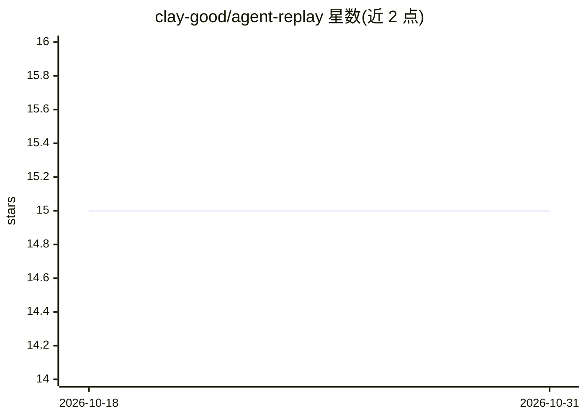

# clay-good/agent-replay

⭐ 15 · TypeScript · MIT · 推送 2026-09-11 · [GitHub](https://github.com/clay-good/agent-replay) · 个人维护

**本地 CLI 工具：AI agent 执行轨迹的录制、回放、diff 与评估**

基于 SQLite 的 100% 本地命令行工具，面向 AI agent 的调试与运维：将每次运行的 thought、tool call、检索与输出记录到单一 SQLite 文件，支持逐步回放（replay）、两次运行差异对比（diff）、从任意步骤 fork 重跑以测试修复。eval 命令用自带 API key（Anthropic/Google/OpenAI）执行幻觉检测、安全审计等确定性规则与 AI 驱动的检查；guard 命令定义 kill-switch 策略阻断危险工具调用；export golden 生成已知正确运行的数据集作为 CI 回归门禁。捕获途径包括 JSON 导入、各 CLI 事件流（Claude Code/Codex/Gemini）、OpenTelemetry 与 hook 约定。要求 Node.js 20.12+，npm 全局安装。

## 筛选速览

| 维度 | 判定 | 备注 |
|---|---|---|
| AI 角色 | `ai-ecosystem` | LLM/agent 周边工具 |
| 许可风险 | `permissive` | MIT |
| 部署形态 | `library` | 以包/库形式分发 |
| 模型依赖 | — | README 未给出锁定关系 |
| 硬件要求 | — | 无带数字的原话,不猜 |
| 安装摩擦 | `low` | 无编译、无系统依赖或容器化 |
| 成熟度 | — | 结构信号不足 |

## 能力要点

- 单一 SQLite 文件存储完整执行轨迹，逐步回放与 fork 重跑
- diff 对比两次运行的分歧步骤及输入输出
- eval 提供幻觉检测、安全审计、质量评分（自带 API key）
- guard 定义 kill-switch 策略，在危险工具调用发生时标记或阻断
- golden 数据集导出作为 CI 回归测试门禁

## 适用场景

- agent 在生产环境出现幻觉后回放执行轨迹定位根因
- 换提示词或换模型后 diff 对比行为差异做回归排查
- 把已知正确的运行固化为 CI 回归门禁
- 对可删除数据、发邮件等危险工具调用设置阻断策略

## 场景标签

`模型评测` `LLM 可观测性` · 领域:评测与运维

## 证据(README 行号)

> L29: A CLI tool that stores agent execution traces in a local SQLite database and gives you tools to debug, evaluate, co
> L33: - More than an observer: enforce guardrails at the moment a dangerous tool call is attempted, and turn known-good r

## 星数曲线

2026-10-18 15 → 2026-10-31 15（+0）

---
*卡片 v1 · prompt 1.4 · 生成 2026-10-30 · 置信度 high · 依据 README sha `f4281e399b24` · [字段定义](../../DATASET.md)*
