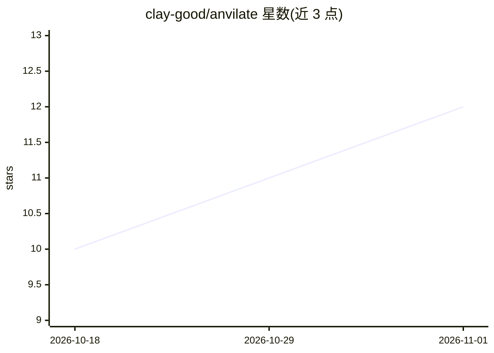

# clay-good/anvilate

⭐ 12 · Python · MIT · 推送 2026-10-25 · [GitHub](https://github.com/clay-good/anvilate) · 个人维护

**本地优先的机械零件工程校核工具：生成参数化 CAD 文件与逐条引用规范的校核记分卡**

面向机械工程师的开源、纯本地工具：通过自有 AI agent（MCP 协议）或手写 YAML 规格与命令行描述零件，执行弯曲、挠度、屈曲、螺栓/焊接连接、公差叠加等闭式解析校核，输出逐条引用规范条款的 Pass/Fail/未评估记分卡，并生成可导入 SolidWorks、CATIA、NX 等的参数化 STEP/DXF 文件与 HTML 报告。自身不含语言模型、不联网、无账号。校核库含 249 个闭式模块；无法运行的检查标记为未评估、不计为通过。pre-alpha 阶段，几何目录、FEA 与语义 PMI 仍在开发中。

## 筛选速览

| 维度 | 判定 | 备注 |
|---|---|---|
| AI 角色 | `ai-enhanced` | 去掉 AI 部分产品仍成立 |
| 许可风险 | `permissive` | MIT |
| 部署形态 | `library` | 以包/库形式分发 |
| 模型依赖 | — | README 未给出锁定关系 |
| 硬件要求 | — | 无带数字的原话,不猜 |
| 安装摩擦 | `low` | 无编译、无系统依赖或容器化 |
| 成熟度 | `idea` | |

## 能力要点

- 249 个闭式解析校核模块（9,313 项测试），每项检查引用规范条款
- 生成参数化 STEP/DXF/3MF 文件并写入 ./anvilate-out
- 纯本地运行：无云、无 LLM、无账号，可完全脱离 agent 以 CLI/YAML 使用
- 通过 MCP server 向 Claude Code、Codex 等 agent 暴露 12 项操作

## 适用场景

- 工程师用自然语言让自家 agent 生成并校核零件，拿到 STEP 文件进 CAD
- 对已有 STEP/DXF/STL/3MF 文件做精确测量与首道工程校核
- 输出航空航天式安全裕度表（CSV/XLSX）供评审使用

## 场景标签

 · 领域:机械工程/CAD 与工程校核

## 证据(README 行号)

> L81: You can also use it with no agent at all: write the spec yourself and run the commands
> L82: below. Anvilate has no language model of its own, calls none, and sends nothing off your
> L167: The goal is a plain-English request that compiles into the same validated scorecard *and* a parametric solid you c

## 星数曲线

2026-10-18 10 → 2026-11-01 12（+2）

---
*卡片 v1 · prompt 1.4 · 生成 2026-11-01 · 置信度 mid · 依据 README sha `297a64b2eb4c` · [字段定义](../../DATASET.md)*
