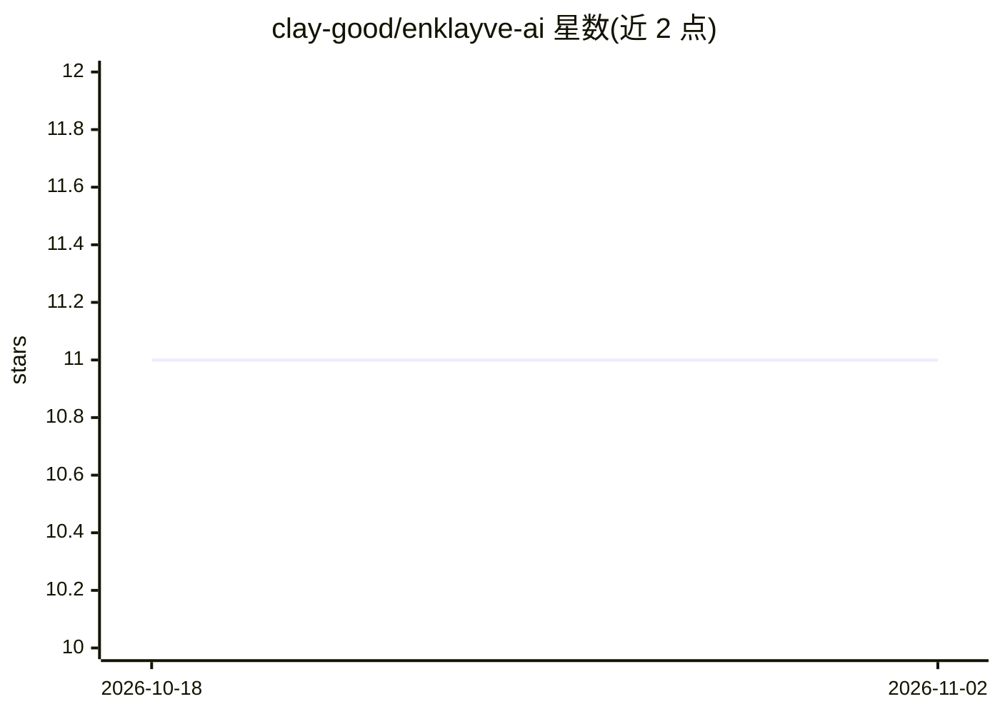

# clay-good/enklayve-ai

⭐ 11 · Rust · MIT · 推送 2026-10-26 · [GitHub](https://github.com/clay-good/enklayve-ai) · 个人维护

**本地运行 AI 模型的隐私文档问答桌面应用**

基于 Tauri/Rust/React 的跨平台桌面应用：用户拖入 PDF、DOCX、TXT、MD 文档，由完全在本机运行的 AI 模型进行问答，可选联网搜索（仅发送问题、不发送文档）。数据加密存储于应用自身文件夹，无账号、无遥测、无 API key。首次运行时自动按硬件挑选并下载模型。提供 macOS/Windows/Linux 安装包，也可用 Rust 与 Node.js 20+ 从源码构建，MIT 许可。

## 筛选速览

| 维度 | 判定 | 备注 |
|---|---|---|
| AI 角色 | `ai-native` | 本体是模型或模型工具 |
| 许可风险 | `permissive` | MIT |
| 部署形态 | `desktop` | 安装包/桌面程序 |
| 模型依赖 | — | README 未给出锁定关系 |
| 硬件要求 | — | 无带数字的原话,不猜 |
| 安装摩擦 | `low` | 无编译、无系统依赖或容器化 |
| 成熟度 | — | 结构信号不足 |

## 能力要点

- AI 模型 100% 本机运行，文档不离设备
- 支持 PDF/DOCX/TXT/MD 文档问答，数据静态加密存储
- 首次运行自动按硬件挑选并下载模型
- 可选 web 搜索且仅上传问题文本

## 适用场景

- 在不联网、不出本机的前提下问答自己的文档
- 无账号无订阅地建立本地文档知识库对话
- 对隐私敏感的笔记和文件做本地 AI 检索问答

## 场景标签

`文档问答` `知识库管理` · 领域:知识与检索

## 证据(README 行号)

> L11: Enklayve runs a capable AI model entirely on your own machine. Ask questions,
> L13: search the web — your files never leave your device. Everything you do is saved

## 星数曲线

2026-10-18 11 → 2026-11-02 11（+0）

---
*卡片 v1 · prompt 1.4 · 生成 2026-11-02 · 置信度 mid · 依据 README sha `3db7bcf23e00` · [字段定义](../../DATASET.md)*
