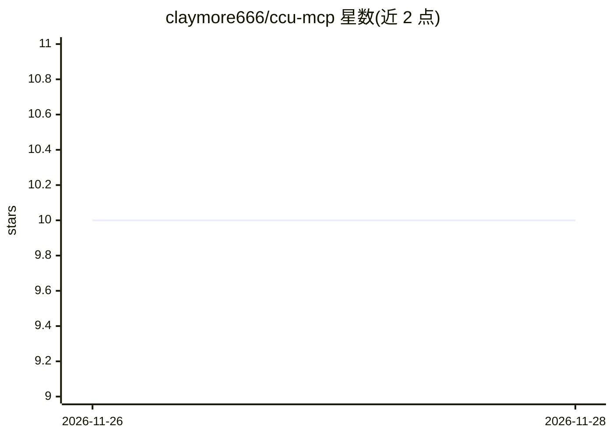

# claymore666/ccu-mcp

⭐ 10 · TypeScript · MIT · 推送 2026-11-23 · [GitHub](https://github.com/claymore666/ccu-mcp) · 个人维护

**把 HomeMatic 智能家居设备暴露为 MCP 工具供 AI 客户端调用**

通过 CCU 内置的 JSON-RPC API（/api/homematic.cgi）连接 HomeMatic 智能家居网关，将设备、房间、程序和系统变量封装为 MCP 工具；设备发现、类型解析、会话管理与数值转换由服务端完成。支持 debmatic、CCU3、OpenCCU 三类 CCU，本地网络直连、无需插件或云端。提供 stdio 与 Docker HTTP 两种运行模式，含 bearer token 认证、TLS 证书固定、CORS/DNS-rebinding 防护与 fail2ban 配置。

## 筛选速览

| 维度 | 判定 | 备注 |
|---|---|---|
| AI 角色 | `ai-ecosystem` | LLM/agent 周边工具 |
| 许可风险 | `permissive` | MIT |
| 部署形态 | `self-host` | docker 或自建部署 |
| 模型依赖 | — | README 未给出锁定关系 |
| 硬件要求 | — | 无带数字的原话,不猜 |
| 安装摩擦 | `low` | 无编译、无系统依赖或容器化 |
| 成熟度 | — | 结构信号不足 |

## 能力要点

- 将设备、房间、程序、系统变量封装为 MCP 工具
- 支持 stdio 与 Docker HTTP 两种部署模式，镜像含 amd64/arm64
- bearer token 认证、TLS 指纹固定、CORS 与 DNS-rebinding 防护
- npx ccu-mcp init 一键探测 CCU 并生成客户端配置

## 适用场景

- 通过 Claude Code 或 Cursor 用自然语言查询和控制 HomeMatic 设备
- 在家庭服务器上以 Docker 独立运行，供多个 MCP 客户端访问
- 批量检查低电量设备、统一设备命名等维护任务

## 场景标签

 · 领域:智能家居/IoT 集成

## 证据(README 行号)

> L11: ccu-mcp connects to the CCU's built-in JSON-RPC API and exposes your devices, rooms, programs, and system variables
> L13: Works with any HomeMatic CCU: debmatic (HomeMatic on Debian), a CCU3, or OpenCCU (formerly RaspberryMatic) — anythi
> L29: The MCP server handles device discovery, type resolution, session management, and value conversion — the AI just ca

## 星数曲线

2026-11-26 10 → 2026-11-28 10（+0）

---
*卡片 v1 · prompt 1.4 · 生成 2026-11-26 · 置信度 high · 依据 README sha `6c4cd8e8a6fb` · [字段定义](../../DATASET.md)*
