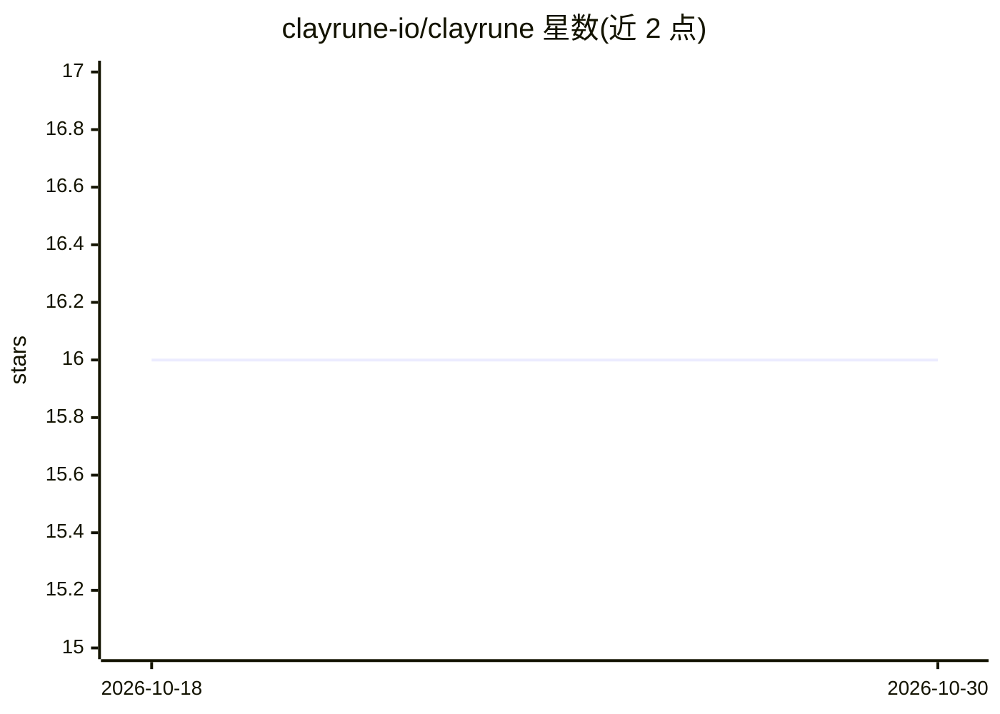

# clayrune-io/clayrune

⭐ 16 · Python · MIT · 推送 2026-10-29 · [GitHub](https://github.com/clayrune-io/clayrune) · [官网](https://clayrune.io) · 组织维护

**本地运行多个 Claude Code agent 的统一仪表盘与调度管理面板**

面向使用 Claude Code CLI 的开发者，提供单面板管理多项目、多并行 agent 会话的自托管仪表盘。在本地机器上以子进程方式启动 claude CLI，配合订阅而非 API。功能含定时调度（once/daily/cron）、跨会话长期记忆、git worktree 隔离、PreToolUse 钩子拦截不可逆命令、GitHub Issues 双向同步、Token 成本统计及手机端经隧道访问。支持 Gemini、Codex、Aider、OpenCode、Goose 等多后端。提供 Windows/macOS/Linux 安装脚本与源码运行（Python 3.9+、Flask）。

## 筛选速览

| 维度 | 判定 | 备注 |
|---|---|---|
| AI 角色 | `ai-ecosystem` | LLM/agent 周边工具 |
| 许可风险 | `permissive` | MIT |
| 部署形态 | `library` | 以包/库形式分发 |
| 模型依赖 | locked-api |  |
| 硬件要求 | — | 无带数字的原话,不猜 |
| 安装摩擦 | `low` | 无编译、无系统依赖或容器化 |
| 成熟度 | — | 结构信号不足 |

## 能力要点

- 以子进程运行 Claude Code CLI，单面板管理多项目多并行 agent
- 定时调度与无人值守运行，含命令拦截钩子与邮件续跑
- 跨会话长期记忆与按项目的记忆预载
- git worktree 隔离防止 agent 互相覆盖；支持 Gemini/Codex/Aider/OpenCode/Goose

## 适用场景

- 同时推进多个项目的 agent 会话并在一处查看状态
- 安排 agent 定时或无人值守运行，需要时再介入
- 在手机上远程查看和干预本地运行的 agent

## 场景标签

`编码 Agent` · 领域:编码与开发

## 证据(README 行号)

> L11: Clayrune is a dashboard over the Claude Code sessions you already run. Every
> L178: instead of a database, and the `claude` CLI spawned as a subprocess. One Python

## 星数曲线

2026-10-18 16 → 2026-10-30 16（+0）

---
*卡片 v1 · prompt 1.4 · 生成 2026-10-30 · 置信度 mid · 依据 README sha `9a8397d35831` · [字段定义](../../DATASET.md)*
