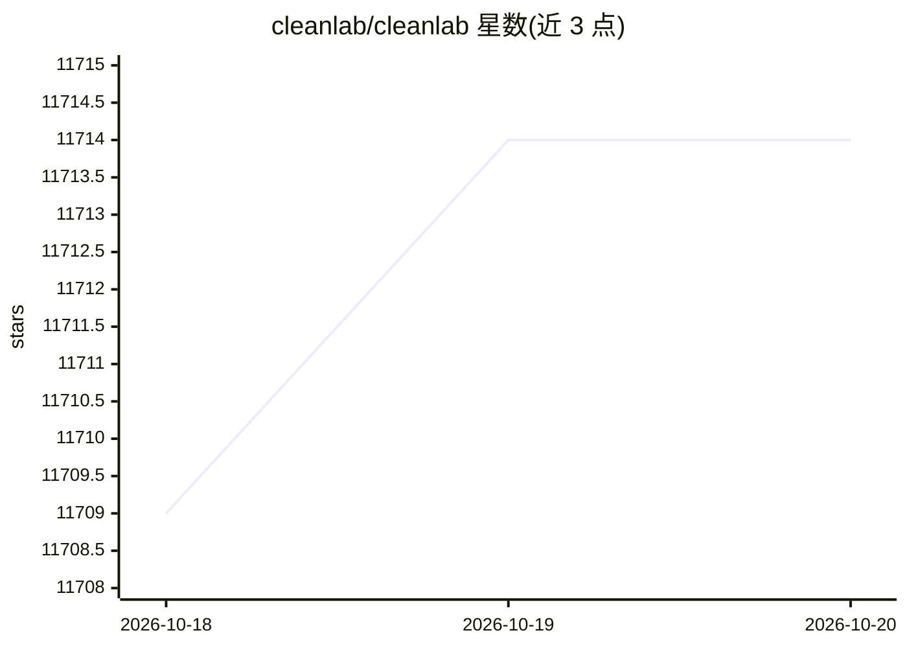

# cleanlab/cleanlab

⭐ 11,714 · Python · Apache-2.0 · 推送 2026-01-13 · [GitHub](https://github.com/cleanlab/cleanlab) · [官网](https://cleanlab.ai) · 组织维护

**面向开发者的数据质量与标签错误检测库（data-centric AI）**

Python 库，用用户已有的 ML 模型输出的特征嵌入与预测概率，自动检测数据集中的标签错误、离群点、重复等问题，支持文本、图像、音频、表格数据。核心机制为 confident learning 算法（JAIR 2021 论文），兼容任意模型（PyTorch/TensorFlow/XGBoost/scikit-learn 等）与分类、回归、目标检测、图像分割、多标注者共识、主动学习等任务。运行需 Python 3.10+，支持 Linux/macOS/Windows。

## 筛选速览

| 维度 | 判定 | 备注 |
|---|---|---|
| AI 角色 | `ai-ecosystem` | LLM/agent 周边工具 |
| 许可风险 | `permissive` | Apache-2.0 |
| 部署形态 | `library` | 以包/库形式分发 |
| 模型依赖 | — | README 未给出锁定关系 |
| 硬件要求 | — | 无带数字的原话,不猜 |
| 安装摩擦 | `low` | 无编译、无系统依赖或容器化 |
| 成熟度 | — | 结构信号不足 |

## 能力要点

- 基于已有模型检测标签错误、离群点、重复等数据问题
- 兼容任意数据类型与任意 ML 模型
- confident learning 算法提供可证明的标签噪声估计
- 支持多标注者共识与质量评估、主动学习任务

## 适用场景

- 训练前清洗带噪声标签的数据集
- 找出数据集中的标注错误与离群样本
- 多标注者数据下推断共识标签与标注者质量
- 主动学习场景下建议下一步标注哪些数据

## 场景标签

 · 领域:数据科学/机器学习工具

## 证据(README 行号)

> L12: Cleanlab’s open-source library helps you **clean** data and **lab**els by automatically detecting issues in a ML da
> L44: All features of cleanlab work with **any dataset** and **any model**. Yes, any model: PyTorch, Tensorflow, Keras, J

## 星数曲线

2026-10-18 11,709 → 2026-10-20 11,714（+5）

---
*卡片 v1 · prompt 1.4 · 生成 2026-10-20 · 置信度 high · 依据 README sha `763c9d14b3bc` · [字段定义](../../DATASET.md)*
