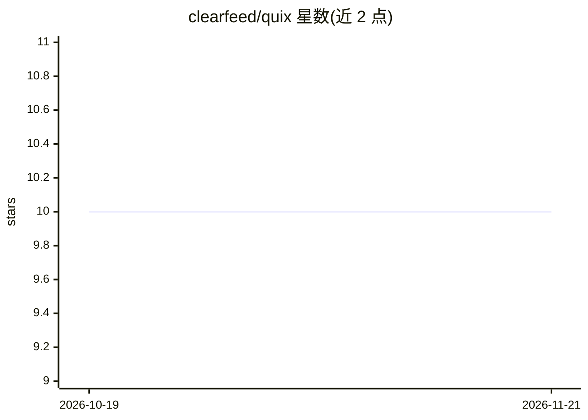

# clearfeed/quix

⭐ 10 · TypeScript · Apache-2.0 · 推送 2026-11-18 · [GitHub](https://github.com/clearfeed/quix) · [官网](https://quixagent.app) · 组织维护

**在 Slack 中用自然语言操作 Jira/GitHub/HubSpot 的 AI 代理**

基于 Nest.js 单体仓库构建的 Slack 代理（agent），用户在 Slack 频道或 1:1 聊天中以自然语言调用 Jira、GitHub、HubSpot、PostgreSQL、Notion、Okta、Salesforce 等业务工具。通过 OpenAI API 生成回复，集成以模块化包形式组织，可在 agent-packages/packages 下按固定结构新增集成包。部署需配置 Slack 应用、PostgreSQL 数据库与 Redis，提供 Docker 与 Docker Compose 运行方式及健康检查端点。

## 筛选速览

| 维度 | 判定 | 备注 |
|---|---|---|
| AI 角色 | `ai-native` | 本体是模型或模型工具 |
| 许可风险 | `permissive` | Apache-2.0 |
| 部署形态 | `self-host` | docker 或自建部署 |
| 模型依赖 | — | README 未给出锁定关系 |
| 硬件要求 | — | 无带数字的原话,不猜 |
| 安装摩擦 | `low` | 无编译、无系统依赖或容器化 |
| 成熟度 | — | 结构信号不足 |

## 能力要点

- 8 个业务工具集成（GitHub/Jira/HubSpot/PostgreSQL/Notion/Okta/Salesforce/Slack）
- Slack 频道与 DM 的自然语言交互
- 模块化集成包架构，按固定结构扩展新集成
- 提供 Docker/Docker Compose 部署与健康检查端点

## 适用场景

- 在 Slack 里直接查改 Jira 工单而不用切工具
- 让团队通过对话查询 HubSpot/Salesforce 客户数据
- 在 Slack 频道中用自然语言执行 GitHub 仓库操作

## 场景标签

`AI 助手` · 领域:对话与助手

## 证据(README 行号)

> L3: Quix is an AI-powered Slack agent that can interact with your business tools such as JIRA, GitHub, HubSpot and more.
> L18: - **AI-Powered Interactions**: Leverages OpenAI for intelligent responses
> L19: - **Slack Integration**: Natural language interactions through Slack channels and DMs

## 星数曲线

2026-10-19 10 → 2026-11-21 10（+0）

---
*卡片 v1 · prompt 1.4 · 生成 2026-11-20 · 置信度 high · 依据 README sha `ebbe45d6fb2d` · [字段定义](../../DATASET.md)*
