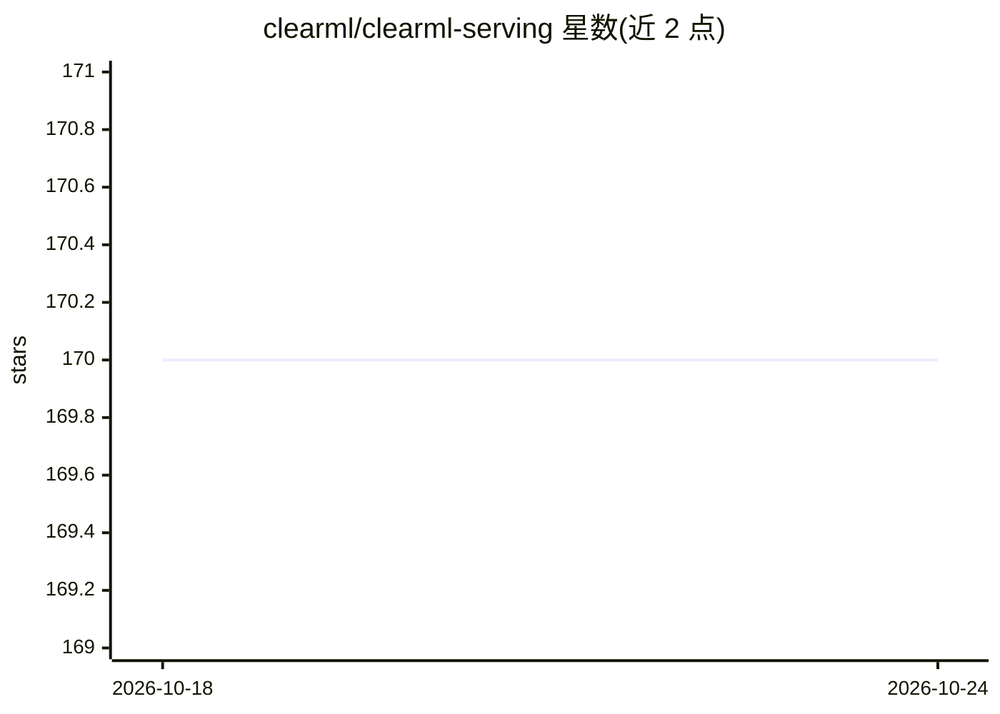

# clearml/clearml-serving

⭐ 170 · Python · Apache-2.0 · 推送 2026-03-12 · [GitHub](https://github.com/clearml/clearml-serving) · [官网](https://clear.ml) · 组织维护

**面向运维开发者的 ML/DL 模型部署与推理服务编排工具**

clearml-serving 是 ClearML 提供的命令行模型部署与编排工具，将机器学习模型（Scikit-learn/XGBoost/LightGBM）与深度学习模型（TensorFlow/PyTorch/ONNX）连同自定义前后处理代码部署到 Kubernetes 集群或自建容器方案。依赖 ClearML Server 作为模型仓库与控制面，支持在线模型升级、Canary A/B 流量切分、自动部署（发布/打标签新版本自动上线）、按负载节点自动扩缩、CPU/GPU 节点与 Triton 推理引擎，并经 Prometheus/Grafana 输出用量与性能指标。安装途径为 pip 安装 CLI 加 docker-compose 或 Helm 启动容器。

## 筛选速览

| 维度 | 判定 | 备注 |
|---|---|---|
| AI 角色 | `ai-ecosystem` | LLM/agent 周边工具 |
| 许可风险 | `permissive` | Apache-2.0 |
| 部署形态 | `self-host` | docker 或自建部署 |
| 模型依赖 | — | README 未给出锁定关系 |
| 硬件要求 | — | 无带数字的原话,不猜 |
| 安装摩擦 | `low` | 无编译、无系统依赖或容器化 |
| 成熟度 | — | 结构信号不足 |

## 能力要点

- 在线添加/升级模型端点，服务不中断
- Canary A/B 端点按权重分流请求
- 模型发布/打标签即自动部署新版本，支持 CI/CD
- 支持 CPU/GPU 节点与 Triton/TorchServe 推理引擎容器
- Prometheus/Grafana 用量与模型性能指标看板

## 适用场景

- 把训练好的 sklearn/PyTorch/ONNX 模型上线为 REST 推理端点
- 灰度发布新模型版本并按比例分流验证
- 在 Kubernetes 上按负载自动扩缩推理服务
- 集中管理多集群、多模型的独立 serving 服务

## 场景标签

`推理引擎` `MLOps` · 领域:训练与推理

## 证据(README 行号)

> L13: **`clearml-serving`** is a command line utility for model deployment and orchestration.
> L22:  * Support Machine Learning Models (Scikit Learn, XGBoost, LightGBM)
> L23:  * Support Deep Learning Models (Tensorflow, PyTorch, ONNX)

## 星数曲线

2026-10-18 170 → 2026-10-24 170（+0）

---
*卡片 v1 · prompt 1.4 · 生成 2026-10-22 · 置信度 high · 依据 README sha `e453b8e4a861` · [字段定义](../../DATASET.md)*
