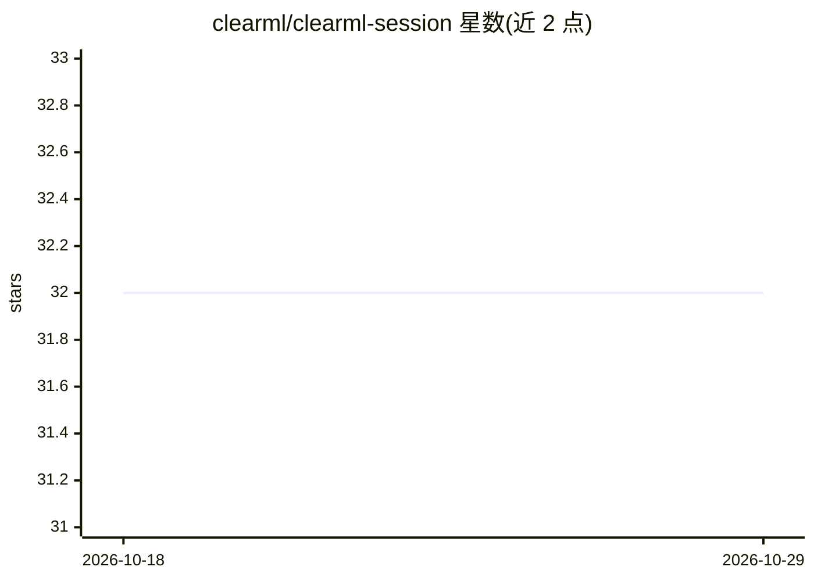

# clearml/clearml-session

⭐ 32 · Python · Apache-2.0 · 推送 2026-03-12 · [GitHub](https://github.com/clearml/clearml-session) · [官网](https://clear.ml) · 组织维护

**在远程机器上启动 JupyterLab/VSCode/SSH 开发会话的 CLI**

ClearML 生态的远程交互式开发会话工具：在本地运行 clearml-session，从专用资源池分配远程实例（含 GPU），并在其上的 Docker 容器内启动 JupyterLab、VSCode Server 与 SSH 访问，供交互式开发使用。通过 SSH 单一加密隧道转发所有连接，支持断线重连不断开底层 socket；支持在 Kubernetes 集群内直接进入 pod 开发、会话工作区快照存储与跨机恢复、上传本地文件、复制历史实验环境进行远程调试。使用需本地有 SSH 客户端且远端运行至少一个 clearml-agent，依赖 ClearML 平台。

## 筛选速览

| 维度 | 判定 | 备注 |
|---|---|---|
| AI 角色 | `ai-ecosystem` | LLM/agent 周边工具 |
| 许可风险 | `permissive` | Apache-2.0 |
| 部署形态 | `library` | 以包/库形式分发 |
| 模型依赖 | — | README 未给出锁定关系 |
| 硬件要求 | — | 无带数字的原话,不猜 |
| 安装摩擦 | `low` | 无编译、无系统依赖或容器化 |
| 成熟度 | — | 结构信号不足 |

## 能力要点

- 一条 SSH 加密隧道转发 SSH/HTTP 连接，重连不破坏现有 socket
- 支持 Kubernetes 集群内 pod 直接开发，用户无需 kubectl
- 工作区快照自动存储与跨会话、跨机器恢复（--store-workspace）
- 复制历史实验（Task）环境到远程会话进行交互式调试

## 适用场景

- 在本地机器资源不足时，申请远程 GPU 容器进行开发调试
- 团队共享 GPU 资源池并动态分配开发环境
- 复制先前实验的完整环境到远程容器做交互式调试
- 居家办公时通过公司 VPN 访问内部专属开发机

## 场景标签

`MLOps` · 领域:训练与推理

## 证据(README 行号)

> L13: **`clearml-session`** is a utility for launching detachable remote interactive sessions (MacOS, Windows, Linux)
> L20: Starting a clearml (ob)session from your local machine triggers the following:
> L21: - ClearML allocates a remote instance (GPU) from your dedicated pool

## 星数曲线

2026-10-18 32 → 2026-10-29 32（+0）

---
*卡片 v1 · prompt 1.4 · 生成 2026-10-26 · 置信度 high · 依据 README sha `21e7b985ce75` · [字段定义](../../DATASET.md)*
