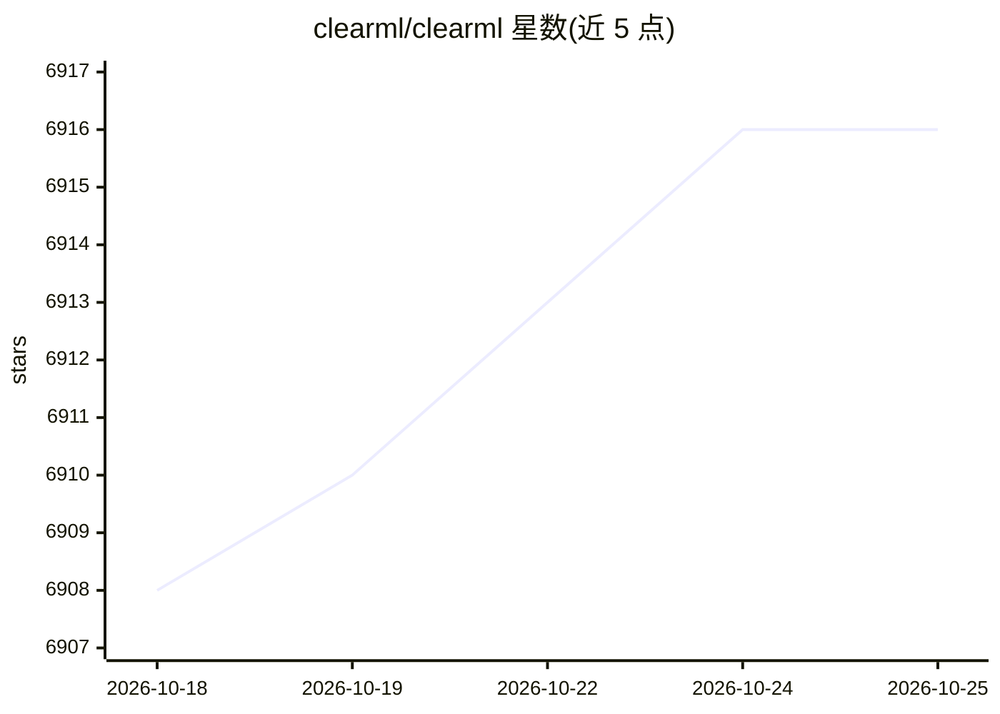

# clearml/clearml

⭐ 6,916 · Python · Apache-2.0 · 推送 2026-10-23 · [GitHub](https://github.com/clearml/clearml) · [官网](https://clear.ml/docs) · 组织维护

**面向 ML/DL 团队的实验追踪、数据管理与 MLOps/LLMOps 编排套件**

ClearML 是一个 ML/DL 开发与生产套件，包含五大模块：Experiment Manager（自动实验追踪）、MLOps/LLMOps 编排与流水线（支持 Kubernetes/云/裸机）、基于对象存储（S3/GS/Azure/NAS）的数据版本管理、支持 Nvidia-Triton 与 GPU 监控的模型服务，以及 Reports 与集群编排仪表盘。SDK 侧只需在代码中添加两行即可接入，配套 clearml-server 存储数据，可使用官方托管服务或自行部署服务器。安装方式为 pip install clearml 后运行 clearml-init 连接服务器。Apache 2.0 许可。

## 筛选速览

| 维度 | 判定 | 备注 |
|---|---|---|
| AI 角色 | `ai-ecosystem` | LLM/agent 周边工具 |
| 许可风险 | `permissive` | Apache-2.0 |
| 部署形态 | `library` | 以包/库形式分发 |
| 模型依赖 | — | README 未给出锁定关系 |
| 硬件要求 | — | 无带数字的原话,不猜 |
| 安装摩擦 | `low` | 无编译、无系统依赖或容器化 |
| 成熟度 | — | 结构信号不足 |

## 能力要点

- 两行代码接入的实验自动追踪（代码版本、超参、stdout/stderr、资源监控）
- 基于 S3/GS/Azure/NAS 对象存储的数据版本管理
- 支持 Nvidia-Triton 的 GPU 模型服务与模型监控
- clearml-agent 远程编排、Kubernetes/云/裸机调度与流水线

## 适用场景

- 团队追踪机器学习实验的代码版本、指标与产出
- 在 Kubernetes 或云上编排训练任务并构建流水线
- 对数据集做版本管理并存储到自有对象存储

## 场景标签

`MLOps` · 领域:训练与推理

## 证据(README 行号)

> L13: ClearML is a ML/DL development and production suite. It contains FIVE main modules:
> L16: - MLOps / LLMOps - Orchestration, Automation & Pipelines solution for ML/DL/GenAI jobs (Kubernetes / Cloud / bare-m
> L17: - Data-Management - Fully differentiable data management & version control solution on top of object-storage

## 星数曲线

2026-10-18 6,908 → 2026-10-25 6,916（+8）

---
*卡片 v1 · prompt 1.4 · 生成 2026-10-20 · 置信度 high · 依据 README sha `02574c3c0bc5` · [字段定义](../../DATASET.md)*
