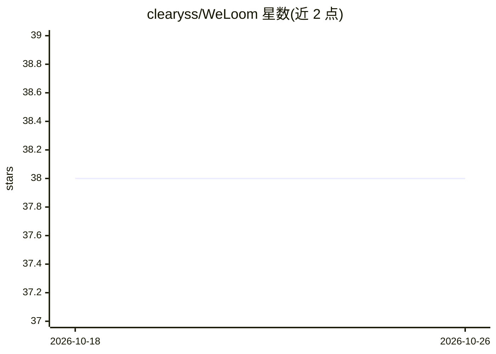

# clearyss/WeLoom

⭐ 38 · Python · AGPL-3.0 · 推送 2026-05-15 · [GitHub](https://github.com/clearyss/WeLoom) · 个人维护 · 中文 README

**将多平台聊天记录转为数字分身的本地聊天记忆系统**

面向个人聊天历史的本地记忆系统：从 QQ（QQChatExporter V5）与微信（WeFlow）导出的 JSON 会话出发，经导入、清洗、切分、SQLite FTS5 索引、长期报告生成与人格画像蒸馏，为模型提供可控记忆上下文，以 CLI（python -m weloom）驱动 build/query/analyze/chat 等命令。核心仅用 Python 标准库 + SQLite，数据默认保存在本地 storage/；长期报告与聊天需配置 OpenAI-compatible API（默认示例 DeepSeek，支持 MiMo），FTS5 不可用时回退词项与 LIKE 检索。GPL-3.0 许可。

## 筛选速览

| 维度 | 判定 | 备注 |
|---|---|---|
| AI 角色 | `ai-native` | 本体是模型或模型工具 |
| 许可风险 | `viral` | AGPL-3.0 |
| 部署形态 | `None` |  |
| 模型依赖 | — | README 未给出锁定关系 |
| 硬件要求 | — | 无带数字的原话,不猜 |
| 安装摩擦 | `low` | 无编译、无系统依赖或容器化 |
| 成熟度 | — | 结构信号不足 |

## 能力要点

- 导入→清洗→索引→蒸馏→报告→人格聊天的完整工作流
- FTS5/词项/trigram/LIKE 多路融合检索与 --show-trace 检索轨迹
- 长期报告（人物报告/主报告/人物档案）与本地或 API 增强人格画像
- Local-first：数据库、画像、报告、缓存默认存于本地 storage/

## 适用场景

- 把我和某人的聊天历史变成可检索的记忆库
- 让 AI 用本人表达风格进行拟真对话
- 把多年聊天记录压缩为长期人物报告与人格画像

## 场景标签

`Agent 记忆` `RAG` `聊天机器人` · 领域:Agent 开发

## 证据(README 行号)

> L17: WeLoom 是一个面向个人聊天历史的 **本地记忆系统**。它从多平台即时通讯导出的 JSON 会话出发，经过导入、清洗、对话切分、词项索引、SQLite FTS、长期报告生成与人格画像蒸馏，最终为模型提供一个可控的记忆上下文，
> L32:  🫧 拟真对话

## 星数曲线

2026-10-18 38 → 2026-10-26 38（+0）

---
*卡片 v1 · prompt 1.4 · 生成 2026-10-25 · 置信度 high · 依据 README sha `7d43a4e544d5` · [字段定义](../../DATASET.md)*
